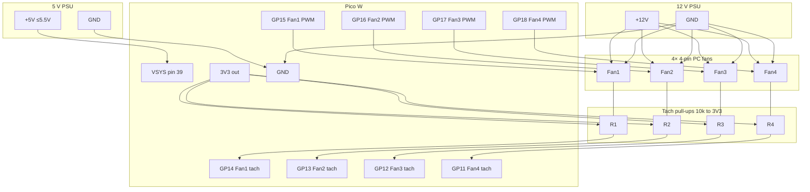

# Pico W Thermal PWM Fan Controller (4 fans)

MicroPython firmware for a **Raspberry Pi Pico W** that drives **up to four 4-pin PC fans** from the **RP2040 die temperature** sensor, with a **Wi-Fi control page** and **Prometheus `/metrics`**.

- **Per-fan PWM** on **GP15 / GP16 / GP17 / GP18** @ **25 kHz** — independent duty each
- **Per-fan tach** on **GP14 / GP13 / GP12 / GP11** (rising IRQ, 2 pulses/rev → RPM each)
- **Die temp** via **ADC(4)** — **not ambient air temperature**
- **Auto / manual** per fan — manual overrides persist in `overrides.json` on the Pico
- **Onboard LED** via `Pin("LED")` on Pico W (falls back to GP25 on classic Pico)
- **Ctrl+C fail-safe**: all PWM → 100%, LED on (does **not** wipe overrides)
- **Optional Wi-Fi** (Pico W): edit [`config.py`](config.py), browse `http://<pico-ip>/`

Typical idle die readings are about **~27–35 °C**. The curve is tuned so **~30 °C die stays at a quiet low duty**, not full speed.

Classic Pico (no radio) still runs fan control; Wi-Fi simply stays disabled.

---

## Safety (read first)

| Rule | Detail |
|------|--------|
| **Never power fans from the Pico** | Fans use an **external 12 V** supply sized for **all** fans. |
| **Power the Pico from regulated ~5 V → VSYS** | Feed **5 V (≤ 5.5 V)** into **VSYS (physical pin 39)**. **Never put 5 V on the 3V3 pin.** |
| **Common ground is required** | Tie **Pico GND**, **5 V PSU GND**, and **12 V fan PSU GND** together. |
| **3.3 V PWM is OK** | Most 4-pin fans accept 3.3 V PWM. Use a **separate** PWM GPIO per fan. |
| **Do not parallel tach lines** | Each tach needs its **own GPIO**. Paralleling open-collectors mixes pulses and corrupts RPM. |
| **External tach pull-ups** | Fit **10 kΩ** from **each** tach line → **Pico 3V3** (not the 5 V rail). |

---

## Pin map & power

| Function | Pico W | Notes |
|----------|--------|--------|
| Board power (~5 V) | **VSYS** (physical **pin 39**) | Regulated **5 V** input (board tolerates up to **5.5 V**) |
| Board / signal ground | **GND** | Common with 5 V and 12 V supplies |
| Logic / tach pull-up rail | **3V3** | Output from onboard regulator — **do not inject 5 V here** |
| Fan 1 PWM | **GP15** | Fan 1 pin 4 |
| Fan 2 PWM | **GP16** | Fan 2 pin 4 |
| Fan 3 PWM | **GP17** | Fan 3 pin 4 |
| Fan 4 PWM | **GP18** | Fan 4 pin 4 |
| Fan 1 tach | **GP14** | Fan 1 pin 3 + **10 kΩ** pull-up to 3V3 |
| Fan 2 tach | **GP13** | Fan 2 pin 3 + **10 kΩ** pull-up to 3V3 |
| Fan 3 tach | **GP12** | Fan 3 pin 3 + **10 kΩ** pull-up to 3V3 |
| Fan 4 tach | **GP11** | Fan 4 pin 3 + **10 kΩ** pull-up to 3V3 |
| Die temperature | **ADC(4)** | On-chip; no external wire |
| Onboard LED | `LED` / GP25 | Status blink |

**USB alternative:** plugging USB powers the board via **VBUS** instead of the external 5 V → VSYS path. Prefer **one** power method at a time for bench setups.

Unused tach pins can stay disconnected (RPM ~0).

---

## Wiring (4 fans, per-fan PWM, external 5 V)

- **Fans:** external **12 V** (+12V / GND tee); **separate PWM** from GP15–GP18; **separate tach** to GP14–GP11.
- **Pico W:** regulated **~5 V → VSYS (pin 39)** + **GND**.
- **Pull-ups:** **10 kΩ** each tach → **Pico 3V3** (never to 5 V / 12 V).

```text
  5V PSU (~5 V, ≤5.5 V)              12V PSU  (fan current + margin)
     +5V ---- Pico VSYS (pin 39)        +12V ----+----+----+----+
     GND --+                             GND     |    |    |    |
           |                              |      |    |    |    |
           |                         COMMON GND  |    |    |    |
           +------ Pico GND <-------------+      |    |    |    |
           |                                     |    |    |    |
           |                                  Fan1 Fan2 Fan3 Fan4  +12V
           |                                  Fan1 Fan2 Fan3 Fan4  GND --> common GND
           |                                  Fan1 PWM <---------------- GP15
           |                                  Fan2 PWM <---------------- GP16
           |                                  Fan3 PWM <---------------- GP17
           |                                  Fan4 PWM <---------------- GP18
           |                                            (25 kHz each)
           |
           |     Pico 3V3 ----+------+------+------+
           |                  |      |      |      |
           |                 10k    10k    10k    10k
           |                  |      |      |      |
           |     Fan1 Tach ---+------|------|------|-------- GP14
           |     Fan2 Tach ----------+------|------|-------- GP13
           |     Fan3 Tach -----------------+------|-------- GP12
           |     Fan4 Tach ------------------------+-------- GP11
           |
           +-- (do NOT feed 5 V into 3V3; 3V3 is Pico output for pull-ups only)

  Alternate Pico power: USB → VBUS (instead of external 5 V → VSYS).
  Never power fans from Pico 3V3 / VSYS / VBUS / USB.
```

### Mermaid diagram



**PSU headroom:** size 12 V current for **all four fans at max**, plus margin. Size the **5 V** rail for the Pico W only (typically well under 0.5 A with Wi-Fi).

---

## Thermal curve (die °C)

`ADC(4)` measures **silicon die temperature**. Ambient is usually cooler. **Auto** fans share this curve; **manual** fans ignore it until returned to auto.

| Die temperature | Auto PWM duty |
|-----------------|---------------|
| **≤ 35 °C** (`MIN_TEMP_C`) | **18%** (`MIN_SPEED`) — quiet idle floor |
| **35 → 55 °C** | Linear ramp 18% → 100% |
| **≥ 55 °C** (`MAX_TEMP_C`) | **100%** |

Tune constants at the top of [`fan.py`](fan.py). Boot holds ~**60% for 1.5 s** on all fans so stubborn fans leave a dead stop, then applies saved overrides.

---

## Wi-Fi control page & API (Pico W)

1. Edit [`config.py`](config.py):
   ```python
   WIFI_SSID = "your-network"
   WIFI_PASSWORD = "your-password"
   WIFI_ENABLED = True
   HTTP_PORT = 80
   ```
2. Leave `YOUR_SSID` / `YOUR_PASSWORD` placeholders to run **fan-only** (no radio join).
3. Flash firmware files (see below).
4. Watch the serial log for `Wi-Fi: connected, IP=…` then open **`http://<pico-ip>/`**.

| Method | Path | Purpose |
|--------|------|---------|
| `GET` | `/` | Control UI — per-fan duty slider, auto/manual, live stats |
| `GET` | `/status.json` | JSON status |
| `POST` | `/api/fans/<id>` | JSON `{"mode":"auto"|"manual","duty":0.0–1.0}` (`id` 1–4; duty required for manual) |
| `POST` | `/api/fans/<id>/auto` | Clear override for one fan |
| `GET` | `/metrics` | Prometheus text exposition |

Examples:

```bash
curl -X POST http://PICO_IP/api/fans/2 -H 'Content-Type: application/json' \
  -d '{"mode":"manual","duty":0.4}'
curl -X POST http://PICO_IP/api/fans/2/auto
curl http://PICO_IP/status.json
curl http://PICO_IP/metrics
```

**Overrides:** successful control POSTs write `overrides.json` on the Pico. Reboot restores them. Fail-safe (Ctrl+C) forces 100% now but does **not** rewrite the file.

**Secrets:** do not commit real Wi-Fi passwords to a public remote.

---

## Flash guide

### 1. Install MicroPython (once)

1. Download the **Pico W** UF2 from [micropython.org](https://micropython.org/download/RPI_PICO_W/).
2. Hold **BOOTSEL**, plug USB, release BOOTSEL.
3. Copy the `.uf2` onto `RPI-RP2`; the board reboots into MicroPython.

### 2. Copy firmware

**Thonny:** save `config.py`, `main.py`, `fan.py`, `web.py`, and `metrics.py` to the Pico.

**mpremote:**

```bash
mpremote connect list
mpremote connect auto cp config.py :config.py
mpremote connect auto cp fan.py :fan.py
mpremote connect auto cp web.py :web.py
mpremote connect auto cp metrics.py :metrics.py
mpremote connect auto cp main.py :main.py
mpremote connect auto reset
```

Serial log (1 Hz) example:

```text
die= 30.2°C  F1=a= 18%= 820 F2=m= 40%= 815 F3=a= 18%= 830 F4=a= 18%=   0
```

(`a` = auto, `m` = manual)

### 3. Stop safely

**Ctrl+C** in the REPL → all PWM **100%**, LED on. Soft reset afterward reloads overrides from flash.

---

## Host unit tests

Pure logic (curve, overrides, metrics, HTTP dispatch) runs on a desktop Python without hardware:

```bash
python3 -m unittest discover -s tests -v
```

---

## Firmware layout

| File | Role |
|------|------|
| [`main.py`](main.py) | Boot, Wi-Fi, sample loop |
| [`fan.py`](fan.py) | PWM/tach, thermal curve, modes, overrides |
| [`web.py`](web.py) | HTTP UI / API / counters |
| [`metrics.py`](metrics.py) | Prometheus text |
| [`config.py`](config.py) | Wi-Fi / port |

---

## Device smoke checklist

1. Serial shows per-fan PWM pins and `die=… F1=a=…`
2. Open `http://<ip>/` — set fan 2 manual 40%; others track temp
3. Reboot — fan 2 still manual 40%
4. `curl http://<ip>/metrics` shows `pico_fan_*` metrics
5. Ctrl+C — fans full speed; soft reboot restores overrides

---

## Hardware you need

- Raspberry Pi Pico W
- Up to four 4-pin 12 V PWM fans
- Regulated **~5 V** supply for **VSYS** (or USB for bench use)
- **12 V** PSU rated for the total fan current + margin
- Common GND across Pico / 5 V / 12 V
- Four **10 kΩ** resistors (tach → 3V3)

---

## License

MIT — use and adapt freely.
