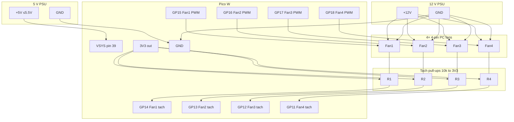
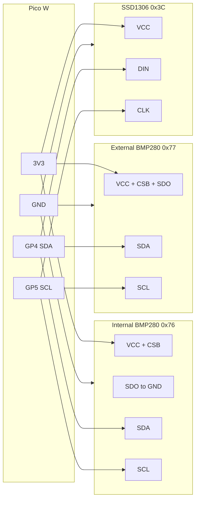

# Pico W Thermal PWM Fan Controller (4 fans)

MicroPython firmware for a **Raspberry Pi Pico W** that drives **up to four 4-pin PC fans** from the **RP2040 die temperature** sensor (or an optional internal BMP280), with a **Wi-Fi control page** and **Prometheus `/metrics`**.

- **Per-fan PWM** on **GP15 / GP16 / GP17 / GP18** @ **25 kHz** — independent duty each
- **Per-fan tach** on **GP14 / GP13 / GP12 / GP11** (rising IRQ, 2 pulses/rev → RPM each)
- **Die temp** via **ADC(4)** — **not ambient air temperature**. If the internal BMP280 is enabled and reading, its temperature drives the auto curve instead
- **Auto / manual** per fan — manual overrides persist in `overrides.json` on the Pico
- **Positive pressure by default:** fans 1 and 2 intake, fans 3 and 4 exhaust, with exhaust duty a bit below intake
- **Optional BMP280** temperature and pressure, internal and external, off until enabled in `config.py`
- **Optional 0.91 inch SSD1306 OLED** (128×32 I2C), also off by default
- **Onboard LED** via `Pin("LED")` on Pico W (falls back to GP25 on classic Pico). Below 50% duty it toggles every 500 ms; at 50% or more it stays on
- **Hardware watchdog** (`machine.WDT`, 8 s by default) fed from the main loop
- **HTTP Basic Auth** on every endpoint, including `/metrics` (disable only by leaving the credentials empty)
- **Ctrl+C fail-safe**: all PWM → 100%, LED on (does **not** wipe overrides). With the watchdog armed, the board then reboots into normal control
- **Optional Wi-Fi** (Pico W): edit [`config.py`](config.py), browse `http://<pico-ip>/`. The link is monitored and reconnected without stopping the fans

Typical idle die readings are about **~27–35 °C**. The curve is tuned so **~30 °C die stays at a quiet low duty**, not full speed.

Classic Pico (no radio) still runs fan control; Wi-Fi simply stays disabled.

---

## Safety (read first)

| Rule | Detail |
|------|--------|
| **Never power fans from the Pico** | Fans use an **external 12 V** supply sized for **all** fans. |
| **Power the Pico from regulated ~5 V → VSYS** | Feed **5 V (≤ 5.5 V)** into **VSYS (physical pin 39)**. **Never put 5 V on the 3V3 pin.** |
| **Common ground is required** | Tie **Pico GND**, **5 V PSU GND**, and **12 V fan PSU GND** together. |
| **3.3 V PWM is OK** | Most 4-pin fans accept 3.3 V PWM. Use a **separate** PWM GPIO per fan. |
| **Do not parallel tach lines** | Each tach needs its **own GPIO**. Paralleling open-collectors mixes pulses and corrupts RPM. |
| **External tach pull-ups** | Fit **10 kΩ** from **each** tach line → **Pico 3V3** (not the 5 V rail). |
| **BMP280 is 3.3 V only** | VCC is **1.8–3.3 V**. Power it from Pico **3V3**. **5 V destroys it.** |
| **Shared 3V3 rail** | If the OLED shares a rail with a BMP280, power that rail from Pico **3V3**, not 5 V. |

---

## Pin map & power

| Function | Pico W | Notes |
|----------|--------|--------|
| Board power (~5 V) | **VSYS** (physical **pin 39**) | Regulated **5 V** input (board tolerates up to **5.5 V**) |
| Board / signal ground | **GND** | Common with 5 V and 12 V supplies |
| Logic / tach pull-up rail | **3V3** | Output from onboard regulator — **do not inject 5 V here** |
| Fan 1 PWM | **GP15** | Fan 1 pin 4 |
| Fan 2 PWM | **GP16** | Fan 2 pin 4 |
| Fan 3 PWM | **GP17** | Fan 3 pin 4 |
| Fan 4 PWM | **GP18** | Fan 4 pin 4 |
| Fan 1 tach | **GP14** | Fan 1 pin 3 + **10 kΩ** pull-up to 3V3 |
| Fan 2 tach | **GP13** | Fan 2 pin 3 + **10 kΩ** pull-up to 3V3 |
| Fan 3 tach | **GP12** | Fan 3 pin 3 + **10 kΩ** pull-up to 3V3 |
| Fan 4 tach | **GP11** | Fan 4 pin 3 + **10 kΩ** pull-up to 3V3 |
| Die temperature | **ADC(4)** | On-chip; no external wire |
| Onboard LED | `LED` / GP25 | Status blink. Do not reuse GP25 |
| I2C0 SDA (default) | **GP4** | Internal BMP280, external BMP280, OLED |
| I2C0 SCL (default) | **GP5** | Same bus |
| I2C1 SDA (spare) | **GP6** | Second bus when a BMP280 address cannot move |
| I2C1 SCL (spare) | **GP7** | Second bus |

**USB alternative:** plugging USB powers the board via **VBUS** instead of the external 5 V → VSYS path. Prefer **one** power method at a time for bench setups.

Leave GP11–GP18 for the fans. On Pico W, leave GP23, GP24, and GP25 alone (wireless) and leave GP29 alone (VSYS sense). The defaults above stay on free GPIOs.

Unused tach pins can stay disconnected (RPM ~0).

---

## Wiring (4 fans, per-fan PWM, external 5 V)

- **Fans:** external **12 V** (+12V / GND tee); **separate PWM** from GP15–GP18; **separate tach** to GP14–GP11.
- **Pico W:** regulated **~5 V → VSYS (pin 39)** + **GND**.
- **Pull-ups:** **10 kΩ** each tach → **Pico 3V3** (never to 5 V / 12 V).

```text
  5V PSU (~5 V, ≤5.5 V)              12V PSU  (fan current + margin)
     +5V ---- Pico VSYS (pin 39)        +12V ----+----+----+----+
     GND --+                             GND     |    |    |    |
           |                              |      |    |    |    |
           |                         COMMON GND  |    |    |    |
           +------ Pico GND <-------------+      |    |    |    |
           |                                     |    |    |    |
           |                                  Fan1 Fan2 Fan3 Fan4  +12V
           |                                  Fan1 Fan2 Fan3 Fan4  GND --> common GND
           |                                  Fan1 PWM <---------------- GP15
           |                                  Fan2 PWM <---------------- GP16
           |                                  Fan3 PWM <---------------- GP17
           |                                  Fan4 PWM <---------------- GP18
           |                                            (25 kHz each)
           |
           |     Pico 3V3 ----+------+------+------+
           |                  |      |      |      |
           |                 10k    10k    10k    10k
           |                  |      |      |      |
           |     Fan1 Tach ---+------|------|------|-------- GP14
           |     Fan2 Tach ----------+------|------|-------- GP13
           |     Fan3 Tach -----------------+------|-------- GP12
           |     Fan4 Tach ------------------------+-------- GP11
           |
           +-- (do NOT feed 5 V into 3V3; 3V3 is Pico output for pull-ups only)

  Alternate Pico power: USB → VBUS (instead of external 5 V → VSYS).
  Never power fans from Pico 3V3 / VSYS / VBUS / USB.
```

### Mermaid diagram



**PSU headroom:** size 12 V current for **all four fans at max**, plus margin. Size the **5 V** rail for the Pico W only (typically well under 0.5 A with Wi-Fi). The BMP280 and OLED draw their logic current from Pico **3V3**.

---

## Optional BMP280 and OLED

Both BMP280s and the OLED are **disabled by default**. Fan control does not open I2C until you set `INTERNAL_BMP280_ENABLED`, `EXTERNAL_BMP280_ENABLED`, or `OLED_ENABLED`. If an enabled part is missing or fails, the firmware logs the error and keeps running. A wrong BMP280 chip id (register `0xD0` must be **`0x58`**) is logged once and that sensor stays rejected.

### Parts

| Part | Role | Default |
|------|------|---------|
| Bosch BMP280 module (for example HandsOn GY-BMP280) | Internal: enclosure air | Off, address **0x76**, I2C0 |
| Second BMP280 | External: outside air | Off, address **0x77**, I2C0 |
| Waveshare 0.91 inch SSD1306 | 128×32 I2C OLED | Off, address **0x3C**, I2C0 |

The OLED module is four pins: VCC, GND, DIN (SDA), CLK (SCL). It has no backlight. A static image can burn in; the firmware rotates pages so the same pixels are not held for the whole run.

### BMP280 pins

| BMP280 | Connect to | Why |
|--------|------------|-----|
| VCC | Pico **3V3** | 1.8–3.3 V module. Not 5 V, not VSYS |
| GND | Pico **GND** | Common with the Pico |
| SDA | **GP4** (default) | I2C data. Needs a pull-up to 3V3 |
| SCL | **GP5** (default) | I2C clock. Needs a pull-up to 3V3 |
| CSB | Pico **3V3** | High at power-up selects I2C. A low CSB locks the chip in SPI until power is removed |
| SDO | **GND** → address **0x76**, **3V3** → address **0x77** | Do not leave SDO floating |

The HandsOn GY-BMP280 guide states that module's address is hardwired to **0x76** (SDO tied to GND on the PCB). If you cannot lift that strap, do not short SDO to 3V3. Put the external sensor on the second bus instead:

```python
EXTERNAL_BMP280_ENABLED = True
EXTERNAL_BMP280_ADDR = 0x76
EXTERNAL_BMP280_I2C_ID = 1
EXTERNAL_BMP280_SDA = 6
EXTERNAL_BMP280_SCL = 7
```

Modules often include about **10 kΩ** pull-ups on SDA and SCL. Those are enough for a short bus. If `scan()` finds nothing, add **4.7 kΩ** from SDA to 3V3 and from SCL to 3V3. Several modules in parallel can share pull-ups; keep the combined value above about **2 kΩ**. The RP2040's internal pull-ups are too weak to rely on.

Keep the external sensor cable short, about **under 50 cm**. Run SDA and SCL with a GND wire. Drop `I2C_FREQ` (default 100 kHz) if a longer cable is noisy. Do not route the I2C pair next to the 25 kHz fan PWM lines.

### OLED pins

| OLED | Connect to |
|------|------------|
| VCC | Pico **3V3** (use 3V3 whenever a BMP280 shares the rail) |
| GND | Pico **GND** |
| DIN / SDA | **GP4** |
| CLK / SCL | **GP5** |

The usual Waveshare address is **0x3C**. If a scan shows **0x3D**, set `OLED_ADDR = 0x3D`.

### Default wiring

```text
  Pico 3V3 ----+----------+----------+----------+
               |          |          |          |
               |         4k7        4k7         |     (add if the modules
               |          |          |          |      have no pull-ups)
               |         SDA        SCL         |
               |          |          |          |
               +-- BMP280 internal SDA/SCL -----+---- GP4 / GP5
               +-- BMP280 external SDA/SCL -----+
               +-- OLED DIN/CLK ----------------+
               |
  Pico 3V3 ----+-- BMP280 internal VCC, CSB
               +-- BMP280 external VCC, CSB, SDO   (SDO high = 0x77)
               +-- OLED VCC
  Pico GND ----+-- all GND, and internal SDO       (SDO low = 0x76)

  Fans stay on GP15-18 (PWM) and GP14-11 (tach). Do not move them onto GP4/GP5.
```



---

## Thermal curve

`ADC(4)` measures **silicon die temperature**. Ambient is usually cooler. When the internal BMP280 is enabled and its latest read succeeded, **that temperature** drives the auto curve instead, and status reports `temp_source` as `internal`. If the sensor is disabled, missing, or fails later, the curve falls back to the die reading (`temp_source` = `die`), including in the middle of a run. Boot always starts on the die sensor, because the BMP280 is opened after the watchdog and the radio.

**Auto** fans share this curve, then the airflow rule below. **Manual** fans ignore both until returned to auto.

| Control temperature | Auto PWM duty |
|-----------------|---------------|
| **≤ 35 °C** (`MIN_TEMP_C`) | **18%** (`MIN_SPEED`) — quiet idle floor |
| **35 → 55 °C** | Linear ramp 18% → 100% |
| **≥ 55 °C** (`MAX_TEMP_C`) | **100%** |

Tune constants at the top of [`fan.py`](fan.py). Boot holds ~**60% for 1.5 s** on all fans so stubborn fans leave a dead stop, then applies saved overrides or the curve. That happens **before** Wi-Fi starts, so a slow association cannot leave the fans at 0% PWM.

Die temperature is the average of 8 `ADC(4)` samples. Tach edges closer than 1 ms apart are ignored (noise); a 10 000 RPM fan still has about 3 ms between pulses.

**Stall:** if a fan's commanded duty is at least `STALL_DUTY_MIN` (default **15%**) and the latest 1 s tach sample is below `STALL_RPM_BELOW` (default **1**, so 0 RPM), status and `pico_fan_stall` report a stall. Duty **0%** is a valid "fan off" and does not alarm. A stopped fan sitting on the 18% idle floor does alarm. The RPM shown on the page is smoothed, so it can still be falling on the sample that first raises stall.

---

## Positive pressure

Default roles are **intake, intake, exhaust, exhaust** (fans 1–2 pull air in, fans 3–4 push it out). In auto mode the exhaust duty is:

```text
exhaust = clamp(intake_duty * AIRFLOW_EXHAUST_RATIO + AIRFLOW_EXHAUST_OFFSET, 0, 1)
```

Defaults are ratio **0.85** and offset **0**. At the 18% idle floor that is **15.3%** exhaust. That is just above the 15% stall threshold, so a fan that does not actually spin at 15.3% will raise a stall alarm. Raise `AIRFLOW_EXHAUST_RATIO` (or lower `STALL_DUTY_MIN` only if you mean to) rather than expecting the exhaust to be lifted back to 18%. The bias is supposed to stay visible. Intake duty still has the 18% floor. Manual mode ignores role, ratio, offset, and the pressure trim.

With both BMP280s reading, status and metrics report `pressure_delta_pa` = internal pressure minus external pressure, in pascals. A positive value means the enclosure is above outside pressure.

`PRESSURE_LOOP_ENABLED` is **False**. Turn it on only if you want a simple trim: while both sensors are ok, exhaust duty also adds `PRESSURE_LOOP_GAIN * (delta_pa - PRESSURE_TARGET_PA)`, then clamps to 0..1. Defaults are target **5 Pa** and gain **0.002** duty per pascal (about 2% duty for a 10 Pa error). Intake fans are not trimmed. If either sensor fails, the trim stops and the ratio/offset rule remains.

---

## Wi-Fi, watchdog, and auth

1. Edit [`config.py`](config.py):
   ```python
   WIFI_SSID = "your-network"
   WIFI_PASSWORD = "your-password"
   WIFI_ENABLED = True
   WIFI_TIMEOUT_S = 20          # one association attempt
   WIFI_RETRY_S = 10            # pause after a failed attempt

   HTTP_PORT = 80
   HTTP_USER = "pico"           # both required; empty → auth off + boot warning
   HTTP_PASSWORD = "change-me"
   METRICS_REQUIRE_AUTH = True  # False exposes /metrics with no credentials

   WDT_ENABLED = True
   WDT_TIMEOUT_MS = 8000        # RP2040 maximum is 8388

   STALL_DUTY_MIN = 0.15
   STALL_RPM_BELOW = 1
   ```
   Peripheral and airflow defaults (all sensors and the OLED stay off):
   ```python
   I2C_FREQ = 100000
   I2C_TIMEOUT_US = 50000

   INTERNAL_BMP280_ENABLED = False
   INTERNAL_BMP280_ADDR = 0x76
   INTERNAL_BMP280_I2C_ID = 0
   INTERNAL_BMP280_SDA = 4
   INTERNAL_BMP280_SCL = 5

   EXTERNAL_BMP280_ENABLED = False
   EXTERNAL_BMP280_ADDR = 0x77
   EXTERNAL_BMP280_I2C_ID = 0
   EXTERNAL_BMP280_SDA = 4
   EXTERNAL_BMP280_SCL = 5

   OLED_ENABLED = False
   OLED_ADDR = 0x3C
   OLED_I2C_ID = 0
   OLED_SDA = 4
   OLED_SCL = 5
   OLED_WIDTH = 128
   OLED_HEIGHT = 32
   OLED_PAGE_S = 3

   FAN_ROLES = ("intake", "intake", "exhaust", "exhaust")
   AIRFLOW_EXHAUST_RATIO = 0.85
   AIRFLOW_EXHAUST_OFFSET = 0.0
   PRESSURE_LOOP_ENABLED = False
   PRESSURE_TARGET_PA = 5.0
   PRESSURE_LOOP_GAIN = 0.002
   ```
   A bad value is logged and replaced (the offending peripheral is disabled, or airflow falls back to these defaults). Fan PWM and tach pins are not reassigned. Two devices on the same I2C id must use the same SDA and SCL. The same address on one bus disables the later device; the same address on two buses is allowed.
2. Leave `YOUR_SSID` to run **fan-only** (no radio join). Fans still spin up and follow the curve.
3. Flash firmware files (see below).
4. Watch the serial log for `Wi-Fi: connected, IP=…` then open **`http://<pico-ip>/`**. The browser prompts for the Basic Auth user and password.

Wi-Fi state (`wifi` in JSON, `pico_fan_wifi_up` in metrics) is refreshed from `isconnected()` about twice a second. Values are `connected`, `connecting`, `timeout`, `offline`, `disabled`, or `unsupported`. `pico_fan_wifi_up` is 1 only while `connected`. After a dropout the link is reported down immediately and `connect()` runs again once the link has stayed down for about a second; a failed attempt waits `WIFI_RETRY_S` before the next try. None of that blocks the 1 s fan loop.

The hardware watchdog is armed **after** `wlan.active(True)` (that call can block) and is fed every pass of the main loop. The association wait itself does not sleep, so it cannot trip the watchdog. The RP2040 cannot turn a watchdog off; Ctrl+C still forces 100% PWM, then the board resets and boots back into normal control. Set `WDT_ENABLED = False` to keep the old "stop in the REPL at 100%" behavior. The 1 Hz status line is a normal `print`; if a USB serial session stops draining that stream, the print can block long enough to trip the watchdog. Close the serial port when you are not watching it, or disable the watchdog while debugging.

Basic Auth is sent on every request in the clear. Use it on a trusted LAN; this firmware does not speak TLS.

If `HTTP_USER` or `HTTP_PASSWORD` is empty, auth is off and the serial log prints a warning. When both are set, **every** path (UI, `/status.json`, `/api/fans…`, `/metrics`, and unknown URLs) returns **401** with `WWW-Authenticate: Basic realm="pico-fan"` until the credentials match. Set `METRICS_REQUIRE_AUTH = False` only when a scraper on a trusted LAN cannot send Basic Auth.

Prometheus scrape with the default (metrics protected):

```yaml
scrape_configs:
  - job_name: pico_fan
    metrics_path: /metrics
    basic_auth:
      username: pico
      password: change-me
    static_configs:
      - targets: ["192.168.1.50:80"]
```

| Method | Path | Purpose |
|--------|------|---------|
| `GET` | `/` | Control UI — per-fan duty slider, auto/manual, role, stall, BMP280 and OLED status |
| `GET` | `/status.json` | JSON status (`wifi`, `ip`, `ssid` are JSON-encoded) |
| `POST` | `/api/fans/<id>` | JSON `{"mode":"auto"\|"manual","duty":0.0–1.0}` (`id` 1–4; duty required for manual). **`Content-Type: application/json` required.** Duty outside 0.0–1.0 is **400** and does not change state |
| `POST` | `/api/fans/<id>/auto` | Clear override for one fan. Same `Content-Type` requirement |
| `GET` | `/metrics` | Prometheus text exposition |

`pico_fan_duty_ratio` is labeled only with `fan`. Mode changes would otherwise split the time series; manual vs auto is `pico_fan_override` (1 = manual). `pico_fan_stall{fan}` is 1 when that fan is stalled. `pico_fan_intake{fan}` is 1 for an intake fan and 0 for exhaust.

`/status.json` adds:

| Field | Meaning |
|-------|---------|
| `control_c` | Temperature currently driving the auto curve |
| `temp_source` | `internal` or `die` |
| `pressure_delta_pa` | Internal Pa minus external Pa, or `null` |
| `sensors.internal` / `sensors.external` | `enabled`, `ok`, `chip_id`, `temp_c`, `pressure_pa`, `error` |
| `oled` | `enabled`, `ok`, `error` |
| `fans[].role` | `intake` or `exhaust` |

`chip_id` is the raw register (`0x58` is JSON `88`). `error` is `starting` after a good init until the first sample, then empty when `ok` is true. A chip id other than `0x58` stays in `error` and `ok` stays false.

Prometheus additions (temperature in Celsius, pressure in pascals):

| Metric | Labels |
|--------|--------|
| `pico_fan_bmp280_up` | `location="internal"` or `"external"`. 1 when that BMP280's latest read succeeded |
| `pico_fan_bmp280_temperature_celsius` | `location`. Omitted while that sensor is not ok |
| `pico_fan_bmp280_pressure_pascals` | `location`. Omitted while that sensor is not ok |
| `pico_fan_pressure_delta_pascals` | Present only when both BMP280s are ok |
| `pico_fan_control_temp_celsius` | Curve input |
| `pico_fan_temp_source_info` | `source="internal"` or `"die"`. 1 on the active source |
| `pico_fan_intake` | `fan`. 1 intake, 0 exhaust |
| `pico_fan_oled_up` | 1 when the OLED is enabled and the last update succeeded |

The OLED, when enabled and present, rotates four pages every `OLED_PAGE_S` (default 3 s): link and source, the four fans (RPM and duty), internal BMP280, external BMP280. Updates happen on the 1 s sample, not on the 10 ms poll.

Examples:

```bash
curl -u pico:change-me http://PICO_IP/status.json
curl -u pico:change-me -X POST http://PICO_IP/api/fans/2 \
  -H 'Content-Type: application/json' \
  -d '{"mode":"manual","duty":0.4}'
curl -u pico:change-me -X POST http://PICO_IP/api/fans/2/auto \
  -H 'Content-Type: application/json' -d '{}'
curl -u pico:change-me http://PICO_IP/metrics
```

The control page's `fetch` calls send `Content-Type: application/json` and surface a failure on the page when the response is not OK. Basic Auth is not attached to cross-site browser requests, and a form post cannot satisfy the JSON content type, which is what blocks the old cross-site control request.

**Overrides:** successful control POSTs write `overrides.json` on the Pico. Reboot restores them. Fail-safe (Ctrl+C) forces 100% now but does **not** rewrite the file.

**Secrets:** do not commit real Wi-Fi or HTTP passwords to a public remote.

---

## Flash guide

### 1. Install MicroPython (once)

1. Download the **Pico W** UF2 from [micropython.org](https://micropython.org/download/RPI_PICO_W/).
2. Hold **BOOTSEL**, plug USB, release BOOTSEL.
3. Copy the `.uf2` onto `RPI-RP2`; the board reboots into MicroPython.

### 2. Copy firmware

**Thonny:** save `config.py`, `main.py`, `fan.py`, `wifi.py`, `web.py`, `metrics.py`, `bmp280.py`, `sensors.py`, `display.py`, `ssd1306.py`, and `settings.py` to the Pico.

**mpremote:**

```bash
mpremote connect list
mpremote connect auto cp config.py :config.py
mpremote connect auto cp fan.py :fan.py
mpremote connect auto cp wifi.py :wifi.py
mpremote connect auto cp web.py :web.py
mpremote connect auto cp metrics.py :metrics.py
mpremote connect auto cp bmp280.py :bmp280.py
mpremote connect auto cp sensors.py :sensors.py
mpremote connect auto cp display.py :display.py
mpremote connect auto cp ssd1306.py :ssd1306.py
mpremote connect auto cp settings.py :settings.py
mpremote connect auto cp main.py :main.py
mpremote connect auto reset
```

Serial log (1 Hz) example:

```text
die= 30.2°C ctl= 28.4°C src=internal  dP=+12Pa  F1=a= 18%= 820 F2=m= 40%= 815 F3=a= 15%= 700 F4=a= 15%=   0!  wifi=connected
```

(`a` = auto, `m` = manual, trailing `!` = stall)

### 3. Stop safely

**Ctrl+C** in the REPL → all PWM **100%**, LED on. With `WDT_ENABLED` (the default) the watchdog then reboots the board, which loads overrides and resumes the curve. With the watchdog disabled, Ctrl+C stays in the REPL at 100% until you reset.

---

## Host unit tests

Pure logic (curve, overrides, metrics, HTTP dispatch) runs on a desktop Python without hardware:

```bash
python3 -m unittest discover -s tests -v
```

---

## Firmware layout

| File | Role |
|------|------|
| [`main.py`](main.py) | Boot, watchdog, sample loop |
| [`fan.py`](fan.py) | PWM/tach, thermal curve, modes, overrides |
| [`wifi.py`](wifi.py) | Non-blocking STA monitor / reconnect |
| [`web.py`](web.py) | HTTP UI / API / Basic Auth |
| [`metrics.py`](metrics.py) | Prometheus text |
| [`config.py`](config.py) | Wi-Fi, auth, watchdog, stall, BMP280, OLED, airflow |
| [`bmp280.py`](bmp280.py) | BMP280 compensation and chip-id check |
| [`sensors.py`](sensors.py) | Shared I2C buses and the two BMP280s |
| [`display.py`](display.py) | OLED pages |
| [`ssd1306.py`](ssd1306.py) | I2C SSD1306 driver (MIT, from micropython-lib) |
| [`settings.py`](settings.py) | Config checks; bad values fall back to safe defaults |

---

## Device smoke checklist

1. Serial shows the PWM pin line before `Wi-Fi: starting radio` (fans are already past the 0% boot gap)
2. With auth configured, a bare `curl` gets **401** and `WWW-Authenticate`
3. Open `http://<ip>/` — set fan 2 manual 40%; others track temp
4. Reboot — fan 2 still manual 40%
5. `curl -u user:pass http://<ip>/metrics` shows `pico_fan_*` metrics, including `pico_fan_stall` and `pico_fan_override`
6. With a BMP280 enabled, `/status.json` shows `sensors.internal.chip_id` of 88 (`0x58`) once it is reading, and `temp_source` switches to `internal`
7. Ctrl+C — fans full speed; with the watchdog on, the board reboots and restores overrides

---

## Troubleshooting I2C

From the REPL, after the firmware has started (or from a short script that constructs `machine.I2C`):

```python
from machine import I2C, Pin
bus = I2C(0, sda=Pin(4), scl=Pin(5), freq=100000)
print(bus.scan())
```

| What you see | What to do |
|--------------|------------|
| `[]` | Check 3V3 and GND, SDA/SCL not swapped, pull-ups to 3V3. CSB must be high before power-up |
| `[118]` only (`0x76`) | Second module is also at 0x76, or it is not powered. Strap SDO to 3V3 only if the PCB does not already short SDO to GND; otherwise use I2C1 |
| `[118, 119]` | Internal `0x76` and external `0x77`. Expected shared-bus pair |
| `60` (`0x3C`) | OLED. Set `OLED_ADDR` if you see `0x3D` (61) instead |
| Serial `chip id 0x.. is not BMP280 (0x58)` | That address answered, but it is not a BMP280. The sensor stays disabled until you fix the wiring and reboot |
| Two devices, one log line about an address conflict | Same address on the same bus. The later device was turned off by `settings.py` |
| Fans reboot every few seconds only after enabling a sensor | A stuck bus with no working timeout can block long enough to trip the 8 s watchdog. The reboot restores fan control. Fix the bus; do not raise the watchdog to hide it |

Unplug a BMP280 or the OLED while running: the next sample logs the failure, `ok` goes false, and auto fans fall back to the die temperature. Plugging it back is picked up on a later sample, except a wrong chip id, which stays rejected.

---

## Hardware you need

- Raspberry Pi Pico W
- Up to four 4-pin 12 V PWM fans
- Regulated **~5 V** supply for **VSYS** (or USB for bench use)
- **12 V** PSU rated for the total fan current + margin
- Common GND across Pico / 5 V / 12 V
- Four **10 kΩ** resistors (tach → 3V3)
- Optional: one or two BMP280 modules, a Waveshare 0.91 inch SSD1306, and **4.7 kΩ** I2C pull-ups if the modules do not already have them

Design notes for this feature: [`docs/superpowers/specs/2026-10-19-bmp280-oled-airflow-design.md`](docs/superpowers/specs/2026-10-19-bmp280-oled-airflow-design.md).

---

## License

MIT — see [`LICENSE`](LICENSE). Copyright (c) 2026 thordin9.
