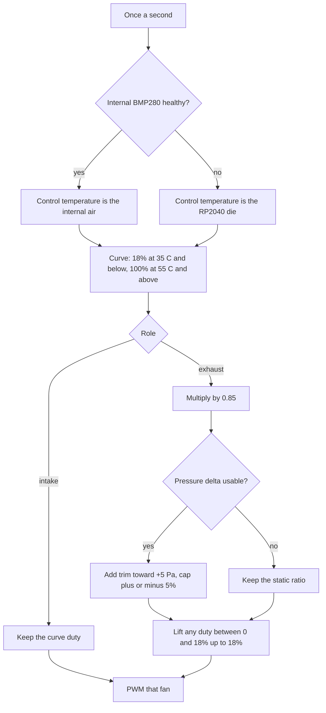
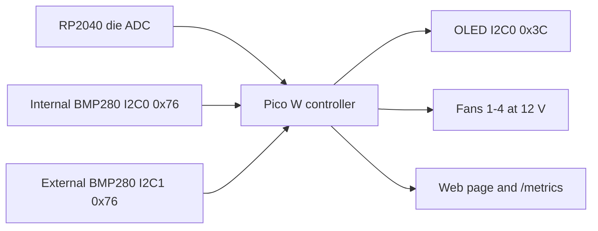

# Pico W fan controller

A Raspberry Pi Pico W running MicroPython drives up to four 12 V PWM fans from the RP2040 die temperature, or from an internal BMP280 when that sensor is healthy. Two BMP280s on separate I2C buses can hold a small positive pressure. A web page, `/metrics`, and an optional OLED show the same state.

| | |
|---|---|
| Fans | GP15–GP18 PWM at 25 kHz, GP14/GP13/GP12/GP11 tach |
| Sensors | BMP280 only, off until you enable them. Internal on I2C0 GP4/GP5, external on I2C1 GP6/GP7, both at `0x76` |
| Display | SSD1306 128×32 on I2C0 at `0x3C`, optional |
| Pressure | Loop on by default: target +5 Pa, trim capped at ±5% duty |
| Idle | Intake and exhaust both sit at 18% when the control temperature is 35 °C or below |

## Contents

- [Safety](#safety)
- [Quick start](#quick-start)
- [How it works](#how-it-works)
- [System](#system)
- [Pins](#pins)
- [Guides](#guides)
- [Serial line](#serial-line)
- [Tests](#tests)
- [License](#license)

## Safety

The Pico's logic is 3.3 V. The fans are 12 V. Those supplies meet only at ground.

- Fan pin 2 (+12 V) comes from the 12 V supply. Never from the Pico, and never from the 5 V rail.
- Pico power is a regulated 5 V into **VSYS (physical pin 39)**, or USB, not both at once. VSYS maximum is 5.5 V.
- **3V3 (physical pin 36) is an output.** Tach pull-ups, BMP280 VCC, and OLED VCC take power from it. Never feed 5 V or 12 V into that pin. A 5 V wire on 3V3 damages the RP2040.
- One common ground ties the Pico, the 5 V supply, and the 12 V supply together.
- Each tach wire gets its own 10 kΩ pull-up to Pico 3V3. Do not pull tach up to 5 V or 12 V, and do not tie two tach wires to one GPIO.
- BMP280 modules in this design are 3.3 V. Do not power them from 5 V just because an OLED breakout allows it.

Full wiring, including the shared-bus alternative, is in [docs/wiring.md](docs/wiring.md).

## Quick start

### Parts

- Raspberry Pi Pico W and a MicroPython UF2 build that includes `network`
- Up to four 4-pin 12 V PWM fans
- A 12 V supply sized for all fans at full speed, plus margin
- A regulated 5 V supply for VSYS (USB is enough on the bench)
- Four 10 kΩ resistors, one per tach wire
- Optional: two BMP280 modules hardwired to `0x76`, a 128×32 SSD1306 at `0x3C`, and 4.7 kΩ I2C pull-ups if the modules do not already have them
- Optional indoor printed case: [enclosure/README.md](enclosure/README.md)

### Wire

1. Common the grounds.
2. 5 V to VSYS pin 39, or plug in USB.
3. Fan pin 1 to ground, pin 2 to 12 V, pin 4 to that fan's PWM GPIO, pin 3 to that fan's tach GPIO with 10 kΩ to 3V3 pin 36.
4. Leave the BMP280s and the OLED unplugged until the fans run. Enabling a sensor in `config.py` before it is wired makes every sample a fault.

The pin table is [below](#pins). Step-by-step for each sensor is in [docs/wiring.md](docs/wiring.md).

### Flash

Copy these files to the Pico filesystem. Copy `main.py` last, because the board runs it on reset.

- `config.py`
- `settings.py`
- `faults.py`
- `fan.py`
- `wifi.py`
- `web.py`
- `metrics.py`
- `bmp280.py`
- `sensors.py`
- `display.py`
- `ssd1306.py`
- `main.py`

`faults.py` is required. `fan.py` imports it at boot; a copy that omits it stops in the REPL with the fans held at 100%.

### Configure

Edit `config.py` on the Pico:

1. Set `WIFI_SSID` and `WIFI_PASSWORD`. Leaving `YOUR_SSID` skips the radio and the fans still run.
2. Set `HTTP_USER` and `HTTP_PASSWORD` together if the Pico is reachable beyond your bench. Either one left empty turns Basic Auth off.
3. Leave `INTERNAL_BMP280_ENABLED`, `EXTERNAL_BMP280_ENABLED`, and `OLED_ENABLED` at `False` until those parts are wired and scanned.

Every option, its default, and when to change it is in [docs/config.md](docs/config.md). The 35 °C / 55 °C / 18% curve is `MIN_TEMP_C`, `MAX_TEMP_C`, and `MIN_SPEED` at the top of `fan.py`, not in `config.py`.

### First boot

Reset the board. For 1.5 seconds all four PWM outputs sit at 60%, so a fan that needs a push can leave a stop. Auto fans then follow the die temperature: 18% at 35 °C or below. The onboard LED blinks while the highest duty is under 50%, and it is solid at 50% or above.

Wi-Fi starts after that spin-up. The hardware watchdog (8 seconds) arms after the radio starts.

### Verify

- The serial line once a second matches the [example](#serial-line). `wifi=connected` and a printed URL mean the page is up.
- Open `http://<ip>/`. The page polls `/status.json` every 2 seconds. With auth on, the browser asks for the username and password (realm `pico-fan`).
- Open `http://<ip>/metrics` with the same credentials unless you set `METRICS_REQUIRE_AUTH = False`.
- A fan that stays at 0 RPM with a duty of 15% or more shows `!` on the serial line and a stall on the page.

If Wi-Fi never connects, the page returns 401, or a fan never spins, use [docs/troubleshooting.md](docs/troubleshooting.md).

## How it works

Once a second the firmware picks a control temperature, runs it through the curve, then treats intake and exhaust differently.



A bad sample is dropped before it can move a duty. The exhaust idle product 0.18 × 0.85 is 15.3%, and that result is lifted to 18% so it sits above the stall line. The plain-language version, with the pressure formula and the fault fallbacks, is [docs/how-it-works.md](docs/how-it-works.md).

## System



Both BMP280s stay at `0x76` because their SDO pins are tied to ground on the module. They use two I2C controllers. Putting the external sensor at `0x77` on I2C0 is an alternative only when that module's SDO can be tied to 3V3. The printed enclosure is built for the two-bus wiring.

## Pins

USB at the top. Pin 1 is GP0. Pin 40 is VBUS. Ground is pins 3, 8, 13, 18, 23, 28, 33, and 38.

| Function | GPIO | Pin |
|----------|------|-----|
| 5 V in | VSYS | 39 |
| 3.3 V out | 3V3(OUT) | 36 |
| Fan 1 PWM / tach | GP15 / GP14 | 20 / 19 |
| Fan 2 PWM / tach | GP16 / GP13 | 21 / 17 |
| Fan 3 PWM / tach | GP17 / GP12 | 22 / 16 |
| Fan 4 PWM / tach | GP18 / GP11 | 24 / 15 |
| I2C0 SDA / SCL | GP4 / GP5 | 6 / 7 |
| I2C1 SDA / SCL | GP6 / GP7 | 9 / 10 |

I2C0 carries the internal BMP280 and the OLED. I2C1 carries the external BMP280. Diagrams and the shared-bus alternative are in [docs/wiring.md](docs/wiring.md).

## Guides

- [Wiring and optional parts](docs/wiring.md)
- [How the control loop decides a duty](docs/how-it-works.md)
- [Config reference](docs/config.md)
- [HTTP API, metrics, Prometheus, and Grafana](docs/api.md)
- [Troubleshooting](docs/troubleshooting.md)
- [Printed enclosure and cable exits](enclosure/README.md)

The October 2026 airflow design is [docs/superpowers/specs/2026-10-19-bmp280-oled-airflow-design.md](docs/superpowers/specs/2026-10-19-bmp280-oled-airflow-design.md). The October 14 per-fan spec and plan describe an earlier firmware and are marked historical.

## Serial line

```text
die= 30.2°C ctl= 28.4°C src=internal  dP=+12Pa loop=on  F1=a=18%= 820 F2=a=18%= 810 F3=a=18%= 790 F4=a=18%= 770  wifi=connected
```

`a` is auto and `m` is manual. `!` after the RPM is a stall. `loop` is `on` when this sample applied the pressure trim, `idle` when the loop is enabled but there is no usable delta, and `off` when the loop is disabled. Duty is a 3-character percent (`18%`, not a padded ` 18%`). Field-by-field notes are in [docs/troubleshooting.md](docs/troubleshooting.md#serial-line).

## Tests

Host tests do not need a Pico:

```bash
python3 -m unittest discover -s tests -v
```

`tests/test_docs.py` checks that every `config.py` setting is named in the config reference, and that the metric names in `metrics.py` are named in the API page.

## License

MIT — see [LICENSE](LICENSE). Copyright (c) 2026 thordin9.
