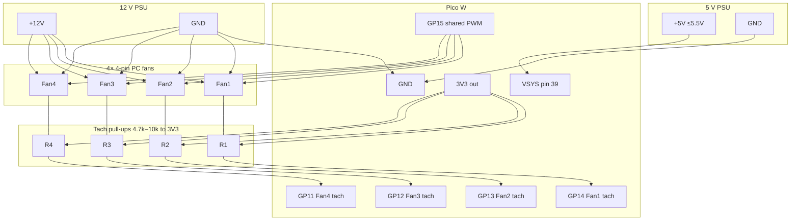

# Pico W Thermal PWM Fan Controller (4 fans)

MicroPython firmware for a **Raspberry Pi Pico W** that drives **up to four 4-pin PC fans** from the **RP2040 die temperature** sensor, with a lightweight **Wi-Fi status page**.

- **Shared PWM** on **GP15** @ **25 kHz** (`duty_u16`) — one signal, same duty for all fans
- **Per-fan tach** on **GP14 / GP13 / GP12 / GP11** (rising IRQ, 2 pulses/rev → RPM each)
- **Die temp** via **ADC(4)** — **not ambient air temperature**
- **Onboard LED** via `Pin("LED")` on Pico W (falls back to GP25 on classic Pico)
- **Ctrl+C fail-safe**: shared PWM → 100%, LED on
- **Optional Wi-Fi** (Pico W): edit [`config.py`](config.py), browse `http://<pico-ip>/`

Typical idle die readings are about **~27–35 °C**. The curve is tuned so **~30 °C die stays at a quiet low duty**, not full speed.

Classic Pico (no radio) still runs fan control; Wi-Fi simply stays disabled.

---

## Safety (read first)

| Rule | Detail |
|------|--------|
| **Never power fans from the Pico** | Fans use an **external 12 V** supply sized for **all** fans. |
| **Power the Pico from regulated ~5 V → VSYS** | Feed **5 V (≤ 5.5 V)** into **VSYS (physical pin 39)**. **Never put 5 V on the 3V3 pin.** |
| **Common ground is required** | Tie **Pico GND**, **5 V PSU GND**, and **12 V fan PSU GND** together. |
| **3.3 V PWM is OK** | Most 4-pin fans accept 3.3 V PWM. Tee the PWM line to every fan. |
| **Do not parallel tach lines** | Each tach needs its **own GPIO**. Paralleling open-collectors mixes pulses and corrupts RPM. |
| **External tach pull-ups** | Fit **4.7 kΩ–10 kΩ** from **each** tach line → **Pico 3V3** (not the 5 V rail). |

---

## Pin map & power

| Function | Pico W | Notes |
|----------|--------|--------|
| Board power (~5 V) | **VSYS** (physical **pin 39**) | Regulated **5 V** input (board tolerates up to **5.5 V**) |
| Board / signal ground | **GND** | Common with 5 V and 12 V supplies |
| Logic / tach pull-up rail | **3V3** | Output from onboard regulator — **do not inject 5 V here** |
| Shared PWM (all fans) | **GP15** | Tee to every fan PWM wire (pin 4) |
| Fan 1 tach | **GP14** | Fan 1 pin 3 + pull-up to 3V3 |
| Fan 2 tach | **GP13** | Fan 2 pin 3 + pull-up to 3V3 |
| Fan 3 tach | **GP12** | Fan 3 pin 3 + pull-up to 3V3 |
| Fan 4 tach | **GP11** | Fan 4 pin 3 + pull-up to 3V3 |
| Die temperature | **ADC(4)** | On-chip; no external wire |
| Onboard LED | `LED` / GP25 | Status blink |

**USB alternative:** plugging USB powers the board via **VBUS** instead of the external 5 V → VSYS path. Prefer **one** power method at a time for bench setups (or use a properly diode-OR’d supply). The diagram below shows the **external 5 V → VSYS** path.

Adjacent GPIOs (15→11) keep breadboard wiring compact. Unused tach pins can stay disconnected (RPM ~0).

---

## Wiring (4 fans, shared PWM, external 5 V)

- **Fans:** external **12 V** (+12V / GND tee); **shared PWM** from GP15; **separate tach** to GP14–GP11.
- **Pico W:** regulated **~5 V → VSYS (pin 39)** + **GND**.
- **Pull-ups:** **4.7 kΩ–10 kΩ** each tach → **Pico 3V3** (never to 5 V / 12 V).

```text
  5V PSU (~5 V, ≤5.5 V)              12V PSU  (fan current + margin)
     +5V ---- Pico VSYS (pin 39)        +12V ----+----+----+----+
     GND --+                             GND     |    |    |    |
           |                              |      |    |    |    |
           |                         COMMON GND  |    |    |    |
           +------ Pico GND <-------------+      |    |    |    |
           |                                     |    |    |    |
           |                                  Fan1 Fan2 Fan3 Fan4  +12V
           |                                  Fan1 Fan2 Fan3 Fan4  GND --> common GND
           |                                  Fan1 Fan2 Fan3 Fan4  PWM \__/__/__/--> GP15
           |                                                            (shared 25 kHz)
           |
           |     Pico 3V3 ----+------+------+------+
           |                  |      |      |      |
           |                4.7-10k 4.7-10k 4.7-10k 4.7-10k
           |                  |      |      |      |
           |     Fan1 Tach ---+------|------|------|-------- GP14
           |     Fan2 Tach ----------+------|------|-------- GP13
           |     Fan3 Tach -----------------+------|-------- GP12
           |     Fan4 Tach ------------------------+-------- GP11
           |
           +-- (do NOT feed 5 V into 3V3; 3V3 is Pico output for pull-ups only)

  Alternate Pico power: USB → VBUS (instead of external 5 V → VSYS).
  Never power fans from Pico 3V3 / VSYS / VBUS / USB.
```

### Mermaid diagram



**Paralleling PWM:** the PWM wire is a **logic-level control input**, not a power rail — one Pico GPIO can drive several fan PWM pins in parallel for most PC fans. Keep leads short. If a particular fan ignores 3.3 V PWM, you need a level shifter (rare).

**PSU headroom:** size 12 V current for **all four fans at max**, plus margin (fans spike at spin-up). Example: 4 × 0.25 A → use at least a ~1.5–2 A supply. Size the **5 V** rail for the Pico W only (typically well under 0.5 A with Wi-Fi).

---

## Thermal curve (die °C)

`ADC(4)` measures **silicon die temperature**. Ambient is usually cooler.

| Die temperature | Shared PWM duty |
|-----------------|-----------------|
| **≤ 35 °C** (`MIN_TEMP_C`) | **18%** (`MIN_SPEED`) — quiet idle floor |
| **35 → 55 °C** | Linear ramp 18% → 100% |
| **≥ 55 °C** (`MAX_TEMP_C`) | **100%** |

Idle die ≈ **30 °C** → quiet floor. Under load, duty ramps; by **55 °C die** all fans are flat-out (same duty).

Tune `MIN_TEMP_C` / `MAX_TEMP_C` / `MIN_SPEED` at the top of [`main.py`](main.py). Boot holds ~**60% for 1.5 s** so stubborn fans leave a dead stop.

---

## Wi-Fi status page (Pico W)

1. Edit [`config.py`](config.py):
   ```python
   WIFI_SSID = "your-network"
   WIFI_PASSWORD = "your-password"
   WIFI_ENABLED = True
   HTTP_PORT = 80
   ```
2. Leave `YOUR_SSID` / `YOUR_PASSWORD` placeholders to run **fan-only** (no radio join).
3. Flash `config.py` **and** `main.py` (see below).
4. Watch the serial log for `Wi-Fi: connected, IP=…` then open **`http://<pico-ip>/`** on the same LAN.
5. JSON mirror: **`http://<pico-ip>/status.json`**.

The page shows die °C, shared PWM %, RPM for fans 1–4, uptime, and link/IP. It auto-refreshes every 2 seconds. The HTTP server is a tiny stdlib socket loop — no extra frameworks.

**Secrets:** do not commit real Wi-Fi passwords to a public remote. Placeholders ship in-repo by design.

---

## Flash guide

### 1. Install MicroPython (once)

1. Download the **Pico W** UF2 from [micropython.org](https://micropython.org/download/RPI_PICO_W/).
2. Hold **BOOTSEL**, plug USB, release BOOTSEL.
3. Copy the `.uf2` onto `RPI-RP2`; the board reboots into MicroPython.

### 2. Copy firmware

**Thonny:** save both `config.py` and `main.py` to the Pico (interpreter: MicroPython Raspberry Pi Pico).

**mpremote:**

```bash
mpremote connect list
mpremote connect auto cp config.py :config.py
mpremote connect auto cp main.py :main.py
mpremote connect auto reset
```

Serial log (1 Hz) example:

```text
die= 30.2°C  duty= 18%  F1= 820 F2= 815 F3= 830 F4=   0
```

### 3. Stop safely

**Ctrl+C** in the REPL → shared PWM **100%**, LED on.

---

## Firmware behaviour

- Four tach IRQs; **all counters read/cleared under `disable_irq` / `enable_irq`**.
- Per-fan RPM is EMA-smoothed and clamped.
- Exceptions / Ctrl+C hit the same **100% fail-safe**.
- Wi-Fi failure does **not** stop thermal control.

---

## Optional extras

- The wiring diagram already includes **per-tach 4.7–10 kΩ pull-ups**; keep them even if RPM looks fine (more reliable edges).
- **PSU current headroom** for simultaneous spin-up of all fans.
- Shorter PWM tee wires / a small buffer if you extend beyond a few fans or long cable runs.
- `WIFI_ENABLED = False` in `config.py` for a wired-only / radio-off deploy.

---

## Hardware you need

- Raspberry Pi Pico W
- Up to four 4-pin 12 V PWM fans
- Regulated **~5 V** supply for **VSYS** (or USB for bench use)
- **12 V** PSU rated for the total fan current + margin
- Common GND across Pico / 5 V / 12 V
- Four **4.7–10 kΩ** resistors (tach → 3V3)

---

## License

MIT — use and adapt freely.
