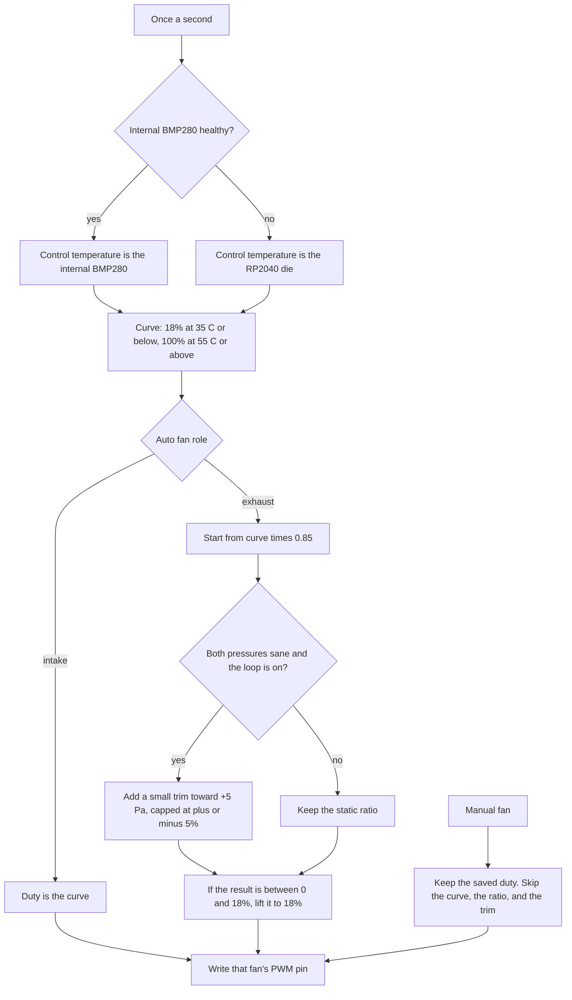

# How it works

The Pico wakes the fans, then once a second it picks a temperature, turns that into a duty, and gives intake and exhaust fans different duties. Anything that does not look like a real sensor reading is left out.



On an auto fan the duty is built in this order:

1. The curve turns the control temperature into a duty.
2. Intake keeps that duty. Exhaust starts at the curve times 0.85, plus the offset.
3. The pressure trim is added only on auto exhaust, and only while the pressure difference is usable.
4. A result that is still above 0 and below 18% is lifted to 18%, which is the floor that stays clear of the stall check.
5. A fault never enters those steps. A bad internal temperature uses the die, a die reading that stays bad uses 55 °C, and a bad pressure difference skips the trim.

## Boot

1. All four fans go to 60% for 1.5 seconds, so a fan that needs a push can leave a dead stop.
2. Saved manual duties in `overrides.json` are restored. Auto fans take the curve from the die temperature. This happens before Wi-Fi starts, so a slow network cannot leave the PWM pins at 0%.
3. The radio starts, then the hardware watchdog (8 seconds). The watchdog is fed on every pass of the loop.
4. I2C opens only if you enabled a BMP280 or the OLED.
5. After that, the internal BMP280 may take over the curve. Until it has a good sample, the die temperature is in charge.

Ctrl+C, or an unexpected error, sets every fan to 100% and turns the LED on. The overrides file is not rewritten. With the watchdog armed, the board then resets and boots back into normal control.

## The curve

`ADC(4)` is the silicon die, not the air in the box. A quiet Pico often sits around 27–35 °C, so the floor is 18% rather than off. Between 35 °C and 55 °C the duty rises in a straight line to 100%.

| Control temperature | Auto intake duty |
|---------------------|-------------------|
| 35 °C or below | 18% |
| 35 °C to 55 °C | Linear, 18% to 100% |
| 55 °C or above | 100% |

Those three numbers are `MIN_TEMP_C`, `MAX_TEMP_C`, and `MIN_SPEED` in `fan.py`.

## Intake and exhaust

Fans 1 and 2 are intake. Fans 3 and 4 are exhaust. Auto exhaust starts at the intake duty times 0.85. At the 18% floor that product is 15.3%, which is only just above the 15% stall line, and many fans will not spin there. Any auto exhaust result that is above 0 and below 18% is lifted to 18%. Duty 0 stays off and does not alarm.

Above the floor the bias shows: 50% intake becomes 42.5% exhaust, and 100% intake becomes 85% exhaust. Manual mode ignores the role, the ratio, and the pressure trim.

## Pressure trim

The difference is internal pressure minus external pressure, in pascals. Positive means the box is above the outside air.

The loop is on by default. Each 1 second sample, while both BMP280s are healthy and the difference is at most 2000 Pa, adds:

```text
trim = clamp(0.0005 * (delta_pa - 5), -0.05, 0.05)
```

That is 0.5% duty for a 10 Pa error, and it cannot grow past ±5% duty. It is not an integrator: the next sample starts again from the 0.85 ratio. If a sensor is missing, failed, or rejected, the trim is skipped and the static ratio remains. The web page says `active`, `idle`, or `off`. The serial line and the OLED say `on`, `idle`, or `off` for the same three states.

## Sensor faults

A reading that cannot be real is thrown away on that sample, even before the warning badge appears.

- The badge latches after 2 bad samples and clears after 3 good ones.
- A step that stays at the new value becomes the new baseline after that clear debounce. A one-sample spike does not.
- BMP280 limits are the datasheet range: −40..85 °C and 300..1100 hPa, plus a 10 °C or 10 hPa jump, or 30 identical raw samples.
- A rejected internal temperature falls back to the die. A rejected pressure falls back to the static exhaust ratio.
- A rejected die reading keeps the last good die value for 5 seconds, then the curve uses 55 °C so the fans go to 100% instead of trusting a dead ADC.
- Tach RPM above 10000 is ignored. RPM while duty is 0 is reported and is not used to clear a stall.

The page shows a line such as `External BMP280: possible fault – pressure out of range`. The same list is in `/status.json` under `faults`. The OLED adds a `SENSOR FAULT` page only while something is latched.

## Stall and the LED

A stall is a commanded duty of at least 15% whose latest 1 second tach sample is 0 RPM. Duty 0 is "fan off", not a stall. The RPM on the page is smoothed, so it can still be falling on the sample that first raises the alarm.

The onboard LED is off when every fan is stopped, solid when the highest duty is 50% or more, and otherwise toggles every 500 ms.

## What a sample cannot break

Wi-Fi, HTTP, the LED, the serial log line, and the sensor read are each wrapped so one failure does not stop the others. The watchdog is fed on the fast 10 ms pass and again around the 1 second sample. Garbage is collected once per sample, after the fans have been updated.
