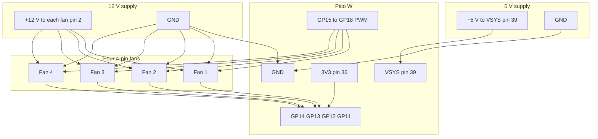
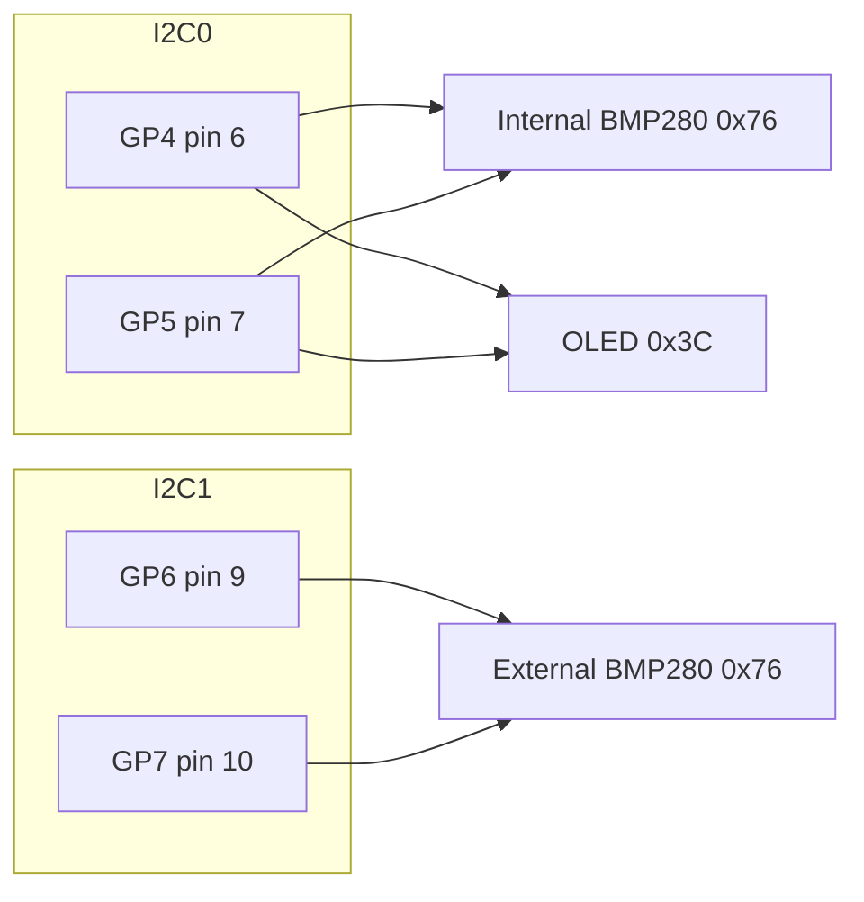

# Wiring

Power and signals use different voltages. Read [Safety](../README.md#safety) before connecting anything.

Standard 4-pin fan plug, wire colours are the usual PC colours:

| Fan pin | Name | Connect to |
|---------|------|------------|
| 1 | GND (black) | Common ground |
| 2 | +12 V (yellow) | 12 V supply, not the Pico |
| 3 | Tach (green) | That fan's tach GPIO, plus 10 kΩ to Pico 3V3 |
| 4 | PWM (blue) | That fan's PWM GPIO |

## Pico W pins

Physical pin numbers match the Raspberry Pi Pico pinout with the USB connector at the top. Pin 1 is GP0, at the top of the left header. Pin 40 is VBUS, at the top of the right header.

| Function | GPIO | Physical pin | Connects to |
|----------|------|--------------|-------------|
| Board power, about 5 V | VSYS | 39 | Regulated 5 V, at most 5.5 V. Or use USB instead, not both |
| Logic 3.3 V output | 3V3(OUT) | 36 | Tach pull-ups, BMP280 VCC, OLED VCC. Never feed 5 V in here |
| Ground | GND | 3, 8, 13, 18, 23, 28, 33, or 38 | Common with the 5 V supply and the 12 V supply |
| Fan 1 PWM | GP15 | 20 | Fan 1 pin 4 |
| Fan 1 tach | GP14 | 19 | Fan 1 pin 3, 10 kΩ to 3V3 |
| Fan 2 PWM | GP16 | 21 | Fan 2 pin 4 |
| Fan 2 tach | GP13 | 17 | Fan 2 pin 3, 10 kΩ to 3V3 |
| Fan 3 PWM | GP17 | 22 | Fan 3 pin 4 |
| Fan 3 tach | GP12 | 16 | Fan 3 pin 3, 10 kΩ to 3V3 |
| Fan 4 PWM | GP18 | 24 | Fan 4 pin 4 |
| Fan 4 tach | GP11 | 15 | Fan 4 pin 3, 10 kΩ to 3V3 |
| I2C0 SDA | GP4 | 6 | Internal BMP280 SDA and OLED DIN |
| I2C0 SCL | GP5 | 7 | Internal BMP280 SCL and OLED CLK |
| I2C1 SDA | GP6 | 9 | External BMP280 SDA |
| I2C1 SCL | GP7 | 10 | External BMP280 SCL |
| Die temperature | ADC(4) | none | On-chip. No wire |
| Onboard LED | `LED` (GP25 on a classic Pico) | none | Do not reuse GP25 |

Leave GP23, GP24, and GP25 for the Pico W radio. Leave GP29 for VSYS measurement. Do not parallel tach wires onto one GPIO.

## Power and fans

```text
  5 V PSU, at most 5.5 V          12 V PSU, sized for all fans
     +5 V ---- VSYS pin 39           +12 V ---- fan pin 2 of each fan
     GND  --+                         GND  --+-- fan pin 1 of each fan
            |                               |
            +--------- COMMON GND ----------+
            |
            +---- Pico GND (any ground pin)

  Pico 3V3 pin 36 ----+----+----+----+
                      |    |    |    |
                     10k  10k  10k  10k
                      |    |    |    |
  Fan1 pin 3 ---------+    |    |    +--------- GP14 pin 19
  Fan2 pin 3 --------------+    |-------------- GP13 pin 17
  Fan3 pin 3 -------------------+-------------- GP12 pin 16
  Fan4 pin 3 ---------------------------------- GP11 pin 15

  Fan1 pin 4 ---- GP15 pin 20     Fan2 pin 4 ---- GP16 pin 21
  Fan3 pin 4 ---- GP17 pin 22     Fan4 pin 4 ---- GP18 pin 24
  Each PWM is 25 kHz. Do not tie the PWM wires together.

  Do not feed 5 V or 12 V into pin 36. 3V3 is an output for the pull-ups.
  USB power is an alternative to the 5 V wire on VSYS, not a second supply.
```



Size the 12 V supply for all four fans at full speed, plus margin. The 5 V supply only runs the Pico, typically well under 0.5 A with Wi-Fi. The sensors draw their current from 3V3.

## Default I2C

Both BMP280 modules are assumed hardwired to address `0x76` (SDO tied to GND on the PCB). They cannot share a bus. The OLED shares I2C0 with the internal sensor because the OLED is at `0x3C`.

| Signal | Internal BMP280 | External BMP280 | OLED |
|--------|-----------------|-----------------|------|
| VCC | 3V3 pin 36 | 3V3 pin 36 | 3V3 pin 36 |
| GND | Pico GND | Pico GND | Pico GND |
| SDA | GP4 pin 6 | GP6 pin 9 | GP4 pin 6, often labelled DIN |
| SCL | GP5 pin 7 | GP7 pin 10 | GP5 pin 7, often labelled CLK |
| CSB | 3V3, high before power-up | 3V3, high before power-up | no CSB pin |
| SDO | GND, address `0x76` | GND, address `0x76` | no SDO pin |

```text
  I2C0, internal BMP280 0x76 and OLED 0x3C
  3V3 pin 36 ----+--------+--------+
                 |       4.7k     4.7k     add these if the modules have no pull-ups
                 |        |        |
                SDA      SCL
                 |        |
                 +-- internal BMP280 SDA/SCL -- GP4 pin 6 / GP5 pin 7
                 +-- OLED DIN/CLK ------------ GP4 pin 6 / GP5 pin 7
  3V3 ---- internal VCC, internal CSB, OLED VCC
  GND ---- internal GND, internal SDO, OLED GND

  I2C1, external BMP280 0x76
  3V3 pin 36 ----+--------+
                 |       4.7k     4.7k
                 |        |        |
                SDA      SCL
                 |        |
                 +-- external BMP280 SDA/SCL -- GP6 pin 9 / GP7 pin 10
  3V3 ---- external VCC and CSB
  GND ---- external GND and SDO
```



Many modules already have about 10 kΩ from SDA and SCL to VCC. That is enough for a short bus. If a scan finds nothing, add 4.7 kΩ on that bus from SDA to 3V3 and from SCL to 3V3. The internal sensor and the OLED share pull-ups; keep the combined value above about 2 kΩ. The RP2040's internal pull-ups are too weak to rely on.

Keep the external cable under about 50 cm, with a ground wire beside SDA and SCL. Do not run it next to the 25 kHz PWM wires.

Chip id register `0xD0` must read `0x58`. Anything else is logged once and that sensor stays rejected until you reboot with the right part.

### Shared-bus alternative

This is not the default. Use it only when the external module's SDO is a free pin you can tie to 3V3, which selects address `0x77`. Then it may share I2C0:

```python
EXTERNAL_BMP280_ADDR = 0x77
EXTERNAL_BMP280_I2C_ID = 0
EXTERNAL_BMP280_SDA = 4
EXTERNAL_BMP280_SCL = 5
```

Do not short a hardwired SDO to 3V3. The printed housings in [`enclosure/`](../enclosure/README.md) are for the two-bus default.

## Enable the internal BMP280

1. Wire VCC and CSB to 3V3 pin 36, GND and SDO to ground, SDA to GP4, SCL to GP5.
2. In `config.py` set `INTERNAL_BMP280_ENABLED = True`. Leave the address at `0x76` and the bus at I2C0.
3. Flash and reboot. The serial log should not say `chip id`.
4. Open `/status.json`. `sensors.internal.ok` becomes true and `chip_id` is 88. `temp_source` becomes `internal`.

## Enable the external BMP280

1. Wire VCC and CSB to 3V3, GND and SDO to ground, SDA to GP6, SCL to GP7. This is a second bus, still at `0x76`.
2. Set `EXTERNAL_BMP280_ENABLED = True`.
3. Reboot. `sensors.external.ok` becomes true.
4. With both sensors healthy and the difference inside 2000 Pa, `pressure_delta_pa` is a number and `pressure_loop_active` is true. A larger difference is dropped and the loop stays idle.

## Enable the OLED

1. Wire VCC to 3V3, GND to ground, DIN to GP4, CLK to GP5. Same four nodes as the internal BMP280.
2. Set `OLED_ENABLED = True`. Leave `OLED_ADDR` at `0x3C` unless a scan shows `0x3D`.
3. Reboot. The panel cycles four pages every 3 seconds: link and temperatures, the four fans, the internal sensor, the external sensor. A fault adds a fifth page.

Printable cases and the cable exits are in the [enclosure guide](../enclosure/README.md).
