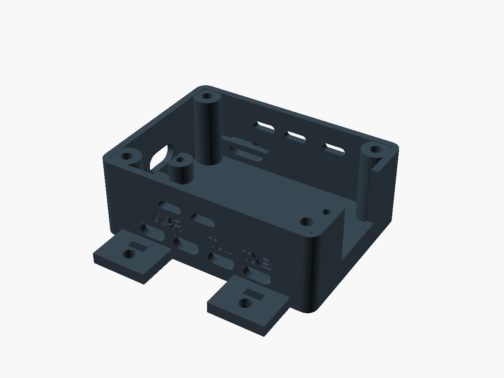
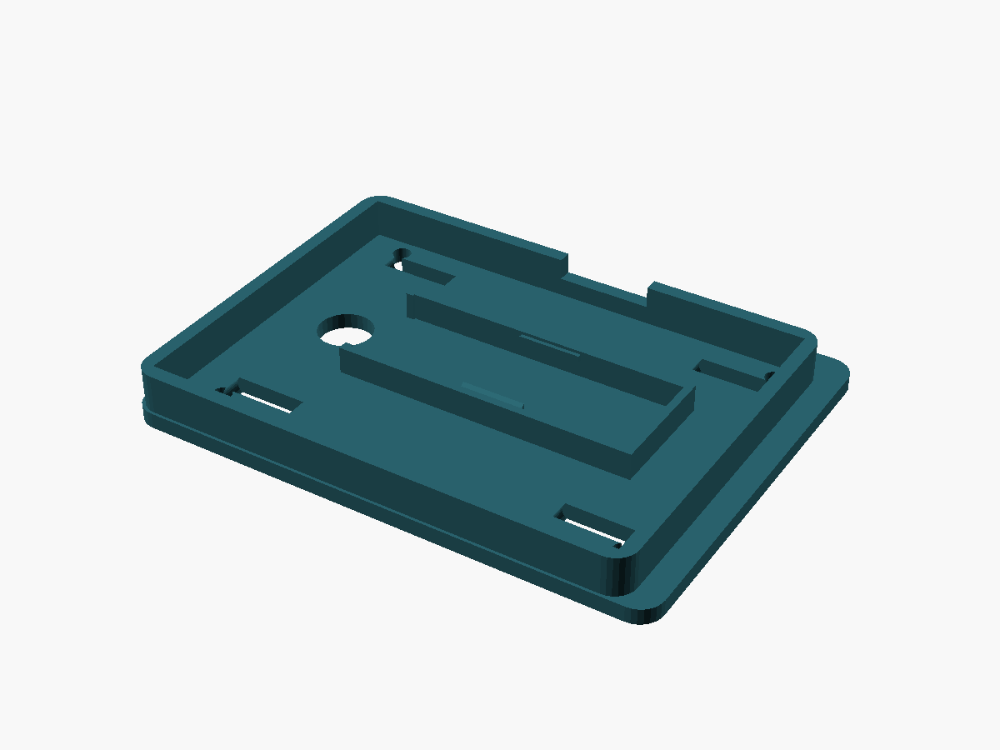
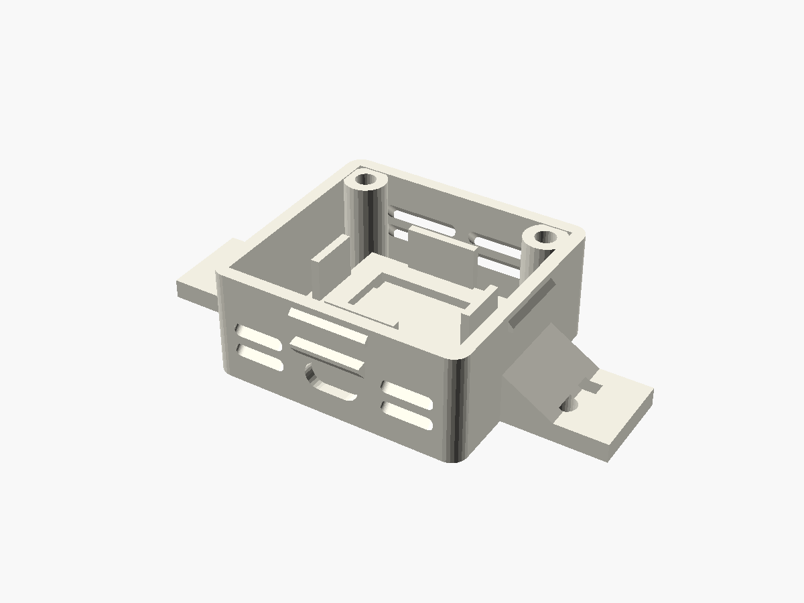

# Pico W and BMP280 enclosures

Parametric 3D-printed parts for the Pico W fan controller: one case for the Pico W and the 0.91" OLED, and one BMP280 housing printed twice (internal and external). Sources live in [`scad/`](scad/). Regenerated meshes are in [`stl/`](stl/), previews in [`renders/`](renders/).

The firmware pin map for the fans is in the repository README. This file is only the mechanical side, including how the two BMP280 cables leave the Pico case.





## Parts

| Print | STL | Qty | Notes |
| --- | --- | --- | --- |
| Pico case base | [`stl/pico_case_base.stl`](stl/pico_case_base.stl) | 1 | Standoffs, cable exits, mounting ears |
| Pico case lid | [`stl/pico_case_lid.stl`](stl/pico_case_lid.stl) | 1 | OLED window, BOOTSEL hole, four lid screws |
| BMP280 body, internal | [`stl/bmp280_int_body.stl`](stl/bmp280_int_body.stl) | 1 | Slotted walls, vented lid, lives in the fan box |
| BMP280 lid, internal | [`stl/bmp280_int_lid.stl`](stl/bmp280_int_lid.stl) | 1 | Debossed **INT** |
| BMP280 body, external | [`stl/bmp280_ext_body.stl`](stl/bmp280_ext_body.stl) | 1 | Sloped louvers, cable awning, solid lid |
| BMP280 lid, external | [`stl/bmp280_ext_lid.stl`](stl/bmp280_ext_lid.stl) | 1 | Debossed **EXT**, small eave, no top vents |

Both sensor housings are the same OpenSCAD file. `variant` is `"INT"` or `"EXT"`.

## Dimensions and where they come from

`scad/dimensions.scad` holds every source number. Derived pockets add `fit_clearance` (0.30 mm) per side. OpenSCAD `assert`s fail the export if a pocket, window, snap, or stack-up stops fitting.

| Item | Value | Source |
| --- | --- | --- |
| Pico W PCB | 51 × 21 × 1 mm | Pico W datasheet, section 2 |
| Pico mounting holes | Ø2.1 mm, 47.0 × 11.4 mm pattern | Datasheet figure 3. Insets are (51−47)/2 = 2.0 mm and (21−11.4)/2 = 4.8 mm |
| USB overhang | 1.3 mm typical | Datasheet figure 3. The connector face sits inside the 2 mm end wall (tip at 0.7 mm), so the plug body stays outside |
| Antenna keep-out | 14 × 9 mm | Datasheet section 2.2.1. The antenna end wall is open across that keep-out |
| Header above the PCB | 8.5 mm | Not a datasheet callout. Standard 0.1" pin header. Override `pico_header_above_pcb` |
| BOOTSEL | 7.5 mm from the USB edge of the PCB, on the centreline, Ø7 hole | The drawing does not locate the button. Nudge `pico_bootsel_from_usb_edge` if the hole misses |
| OLED module | 36.0 × 12.5 mm, active area 22.38 × 5.58 mm | Waveshare 0.91" SSD1306 wiki / selection table |
| OLED window | 22.78 × 5.98 mm | Active area plus 0.40 mm |
| OLED stack | PCB 1.20 + glass 1.45 = 2.65 mm | Thickness is not published by Waveshare. 1.45 mm is the matching 0.91" 128×32 panel (EastRising ER-OLED0.91-1). Remeasure and set `oled_pcb_t` / `oled_glass_t` |
| BMP280 module | 21 × 18 mm, six pins | HandsOn Technology user guide (GY-BM E/P 280) |
| BMP280 thickness / pitch | 1.6 mm, 2.54 mm | Not printed as text in that guide. 1.6 mm matches the stated 1.18 g mass; 2.54 mm is the usual pitch of this row and fits the 21 mm edge. The cradle uses the 21 × 18 outline, not unpublished module holes |
| Walls, floor, lid | 2.0 mm | Five 0.4 mm perimeters |
| Pico case outside | 63 × 47 × 23 mm | PCB, 11 mm gutters for Dupont leads, 8 mm antenna gap, 6 mm standoffs |
| BMP280 body outside | 39.4 × 36.4 × 16.9 mm, plus 16 mm tabs | 7.2 mm of still air around the module so the corner bosses clear the board |

Header plastic width, the micro-USB shell (8.0 × 3.8 mm), and the PH2.0 shroud width (10.5 mm) are named because they are not in those drawings. The PH2.0 plug has to stay narrower than the gap between the Pico header rows (15.24 mm).

## Cable routing

The two BMP280 boards are both hardwired to I2C address **0x76** (SDO already tied to GND on the PCB). They cannot share a bus, and no SDO strap is added in the housing. CSB stays on the module as well: I2C mode wants it high, and these boards already do that. Do not bring SDO or CSB out through the cable slot. If a different breakout leaves either pin floating, tie it at the module (SDO to GND, CSB to 3V3), still with only four wires leaving the housing.

The firmware can instead put a sensor at **0x77** on I2C0 when that module's SDO is free and tied to 3V3. These printed parts are for the default, not that option: two 0x76 boards, two buses, two cable exits.

Each sensor is a **4-wire** cable: **VCC, GND, SCL, SDA**. The Pico case has a separate exit for each cable, plus two fan exits and one power exit. The OLED does not use those exits; its PH2.0 lead stays inside the case.

| Exit (debossed) | Wall | Lands on | Cable |
| --- | --- | --- | --- |
| **FAN** (two slots) | Cable wall, USB end | GP15–GP18 PWM, GP14–GP11 tach | Split the four fans across the two slots, two fans each. Tach pull-ups are 10 kΩ to Pico **3V3** |
| **INT** | Cable wall | **I2C0: GP4 SDA, GP5 SCL** | Internal BMP280. VCC from Pico **3V3**, GND. Same two GPIO as the OLED |
| **EXT** | Cable wall, antenna end | **I2C1: GP6 SDA, GP7 SCL** | External BMP280. VCC from Pico **3V3**, GND. Nothing else on this bus |
| **PWR** | Opposite wall | VSYS and the fan supply | Regulated 5 V into **VSYS (physical pin 39)**, external 12 V for the fans, and the common ground |

The OLED PH2.0 (VCC, GND, SDA, SCL) is plugged inside the case onto the same I2C0 pins as the INT cable: VCC and GND to 3V3 and GND, SDA to GP4, SCL to GP5. Parallel the INT cable onto those four points. Do not also connect the EXT cable there.

A zip-tie cleat crosses each exit, one tie per cable, so the two I2C runs cannot be pulled into each other's opening. On the sensor housings the cleat is just inside the 4-wire slot.

Fan power and tach rules are unchanged from the controller README: fans take 12 V from their own supply, never from the Pico; 5 V into VSYS only; one common ground.

## Where to put the sensors

Print the INT housing and mount it **inside** the fan enclosure:

- Out of the fan blast. The slots are a shield, not a duct.
- Away from the motor body and away from the Pico's regulator and the 12 V wiring.
- Lid up. The cradle stands on four thin legs so the board is not shorted to the plastic.

Print the EXT housing and mount it **outside**:

- Lid up, cable leaving the low side. The louvers slope up toward the inside and the cable has a short awning; both only shed water in that orientation.
- A drip loop on the cable before it enters the slot.
- Shade, not in the fan exhaust and not on a sunlit metal panel. The board only touches the four legs and two optional hold-down posts.
- Tabs take an M3 screw or a zip tie into a shelf. Do not put the flat bottom against a vertical wall; the louvers would no longer face down-and-out.

## Hardware

Heat-set inserts are M2, 3.5 mm OD × 3 mm long (short Ruthex-style). The printed hole is Ø3.2 mm × 3.6 mm deep.

| Qty | Fastener | Where |
| --- | --- | --- |
| 8 | M2 insert 3.5 × 3 mm | Pico standoffs (from **below**) and the four lid bosses (from **above**, before the lid goes on) |
| 4 | M2×8 pan head | Down through the Pico's own holes into the standoffs. About 2 mm of thread enters the insert. A longer screw bottoms in the pocket |
| 4 | M2×5 pan head | Lid to the corner bosses. M2×6 bottoms out in the 3.6 mm pocket |
| 4 | M3 pan head, or 4 zip ties | Pico mounting ears. Clearance is Ø3.4 mm; zip slot is 5.0 × 2.2 mm. Length depends on the panel |
| 4 | M3, or zip ties | Two tabs on each sensor housing |
| 2–4 | M2 insert + M2×5 | Optional. The sensor lids snap on (0.45 mm engagement). Screws are a second closure, two per lid, inserts from the top of the back-corner bosses |
| 7 | Small zip ties | Five Pico exits (two FAN, INT, EXT, PWR) and one cable cleat in each sensor housing |

If you skip the optional sensor-lid screws you need 8 inserts, not 12.

## Print settings and orientation

- Nozzle 0.4 mm, layer 0.20 mm, **5 perimeters** so the 2 mm walls are solid, 4–5 top/bottom layers, 20% infill.
- PLA or PETG. For the external housing prefer a light PETG or ASA. Dark PLA in the sun will heat the sensor.
- **No supports.** Bodies sit on the bed as modelled (tabs and floor down). Louvers are horizontal bridges (INT) or 45° sloped ducts (EXT). The external cable awning rises at 45°.
- Lids are modelled **outer face down**, which is the print orientation. The debossed INT/EXT mark is in the first layers. The skirt and the OLED nest build upward.
- The Pico lid's OLED clips are 45° ledges. If a clip fails, print that lid slower with more cooling rather than adding support under the nest.

## Assembly

1. Press four inserts into the Pico standoffs from the **bottom** of the base, and four into the lid bosses from the **top**. Seat them flush. Do this before the boards go in.
2. Optional: press two inserts into the back corners of each sensor body.
3. Set the Pico on the standoffs, USB toward the USB opening, antenna toward the open end wall. M2×8 down through the Pico holes.
4. Fan leads out the two **FAN** slots, INT cable out **INT**, EXT cable out **EXT**, 5 V and 12 V in through **PWR**. One zip tie per cleat.
5. Plug the OLED into I2C0 (GP4/GP5, 3V3, GND) and slide the module into the lid nest, glass toward the window, PH2.0 toward the USB end. The clips grab the back of the PCB. The nest is shifted toward the antenna so it clears the BOOTSEL hole and the USB shell.
6. M2×5 through the lid into the corner bosses. BOOTSEL is the round hole near the USB end of the lid.
7. Sensor boards sit in the cradle, pin row toward the cable slot, chip up. Only four wires leave. Close the lid until the four snaps click. The fingernail notch is on the cable side. Optional M2×5 screws go through the lid into the back-corner bosses.
8. Mount INT inside the fan box and EXT outside, both lid-up, as above.

## Adjusting the model

From `enclosure/`:

```bash
./export.sh
```

`QUALITY=32 ./export.sh` is a faster mesh. The default is 48. The script refuses a mesh that is not a single shell, and it checks that the USB opening, the separate INT and EXT exits, the OLED window, the BOOTSEL hole, and the sensor louvers are actually open.

Overrides are normal OpenSCAD `-D` flags, for example:

```bash
openscad -D 'fit_clearance=0.40' -D 'variant="EXT"' -D 'part="body"' \
  -o /tmp/ext.stl --export-format binstl scad/bmp280_housing.scad
```

| Knob | What it does |
| --- | --- |
| `fit_clearance` | Extra room per side around the Pico is not used for the PCB (the gutters are separate). It grows the OLED pocket and the BMP280 cradle. Keep it between 0.20 and 0.60 mm |
| `pico_header_above_pcb` | Raise this if your headers are taller than 8.5 mm. The case grows with it and the OLED nest is checked against the pins |
| `pico_bootsel_from_usb_edge` | Move the BOOTSEL hole along the board. The OLED nest must stay clear of it |
| `oled_pcb_t`, `oled_glass_t` | Stack height if you remeasure the module |
| `bmp_air` | Still air between the BMP280 and the shell. It also makes room for the corner inserts |
| `bmp_pcb_t`, `bmp_pin_pitch` | If your module is not 1.6 mm or the row is not 2.54 mm |
| `pico_standoff_h` | More room under the board for solder tails. The datasheet notes solder under the USB connector can hold a bare board off the table |
| `variant`, `part` | `"INT"` / `"EXT"` and `"body"` / `"lid"` / `"assembly"` / `"section"` |

`assembly` and `section` are previews, not print files. The section cuts the part on the centreline and leaves the board in place so you can see the cradle and the standoffs.
