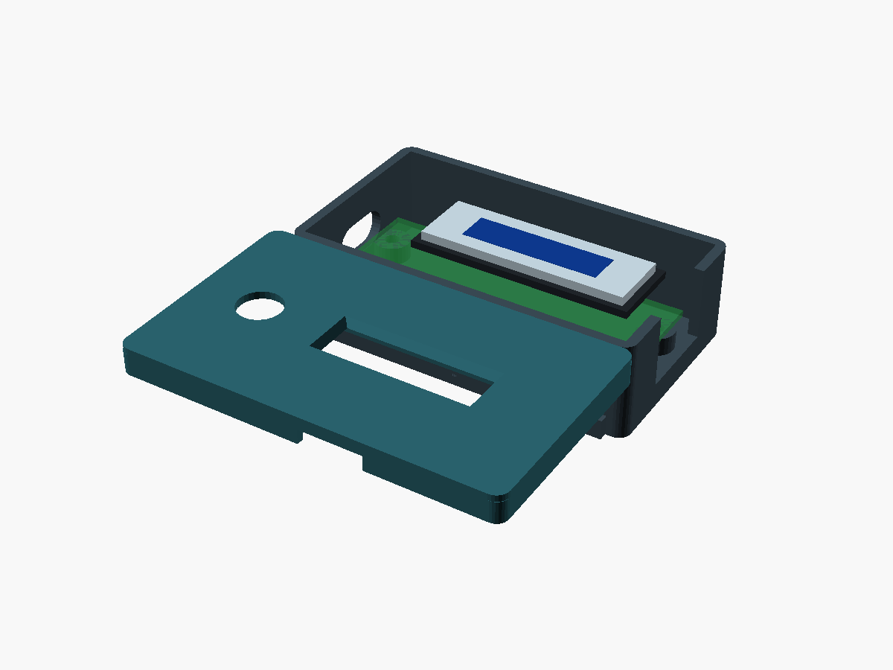
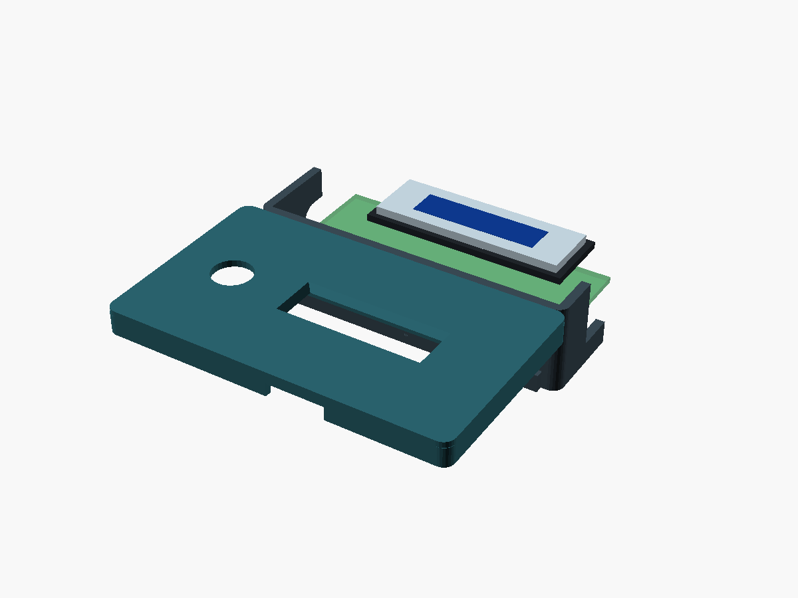
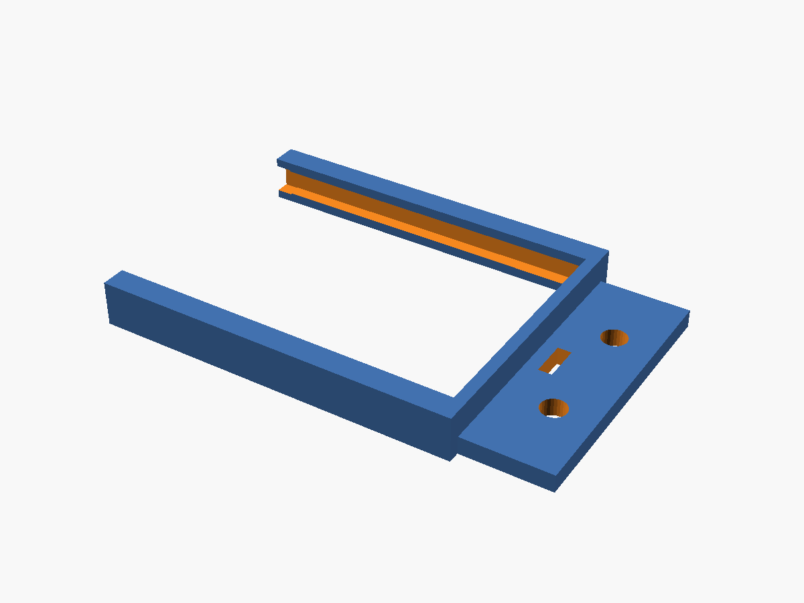
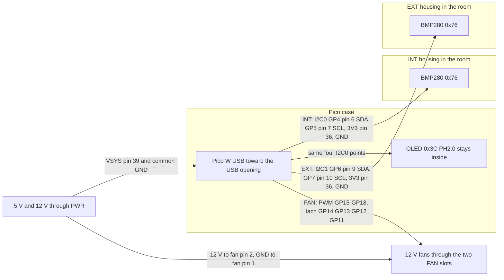
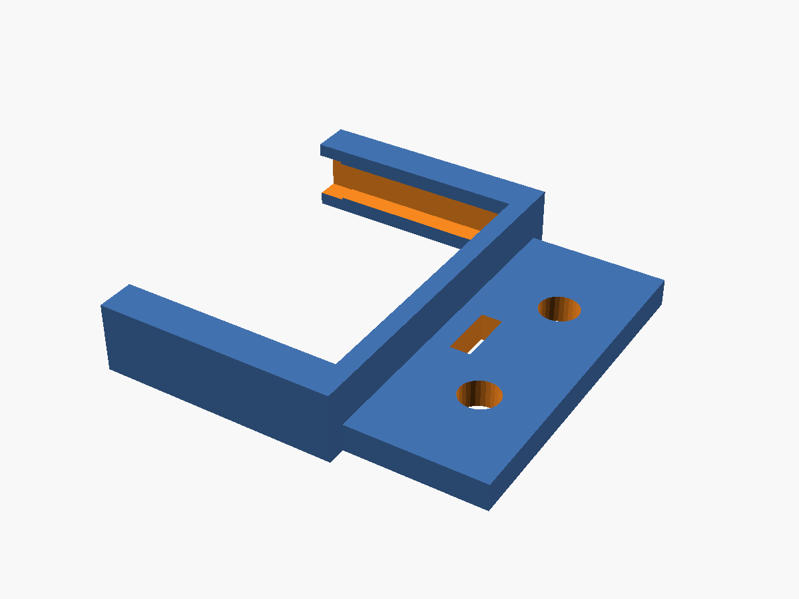

# Pico W and BMP280 enclosures

Parametric 3D-printed parts for the Pico W fan controller. The cases are for a controlled indoor room: thin walls, no rain awning, no drip loop, and no radiation-shield louvers. One BMP280 body is printed twice; only the lid label changes (`INT` or `EXT`).

Sources are in [`scad/`](scad/). OpenSCAD meshes are in [`stl/`](stl/), previews in [`renders/`](renders/). Matching FreeCAD models are in [`freecad/`](freecad/).





## Parts

| Print | STL | Qty | Notes |
| --- | --- | --- | --- |
| Pico case base | [`stl/pico_case_base.stl`](stl/pico_case_base.stl) | 1 | Standoffs, cable exits, slide rails. Flat bottom |
| Pico case lid | [`stl/pico_case_lid.stl`](stl/pico_case_lid.stl) | 1 | Through OLED window with a viewing chamfer, BOOTSEL hole, snaps |
| BMP280 body | [`stl/bmp280_int_body.stl`](stl/bmp280_int_body.stl) | 2 | One print for INT, one for EXT. Same solid |
| BMP280 lid, internal | [`stl/bmp280_int_lid.stl`](stl/bmp280_int_lid.stl) | 1 | Two vents, debossed **INT** |
| BMP280 lid, external | [`stl/bmp280_ext_lid.stl`](stl/bmp280_ext_lid.stl) | 1 | Same vents, debossed **EXT** |
| Pico wall bracket | [`stl/mount_pico.stl`](stl/mount_pico.stl) | 0–1 | Optional. Slides onto the Pico rails |
| BMP280 wall bracket | [`stl/mount_bmp.stl`](stl/mount_bmp.stl) | 0–2 | Optional. One per sensor housing |

`bmp280_ext_body.stl` is the same geometry as the INT body, so either file is the sensor body. `variant` only changes the lid text.

## Old and new outside dimensions

Ears, tabs, the cable awning, and the tall still-air cavity are gone. The slide rails add 1.4 mm per long side and are the only thing the bracket holds. Without a bracket the bottom is flat.

| Part | Previous | Now |
| --- | --- | --- |
| Pico base, body | 63 × 47 × 23 mm | 56.7 × 32.2 × 15.5 mm |
| Pico base, including fixed ears | 63 × 71 × 23 mm | no ears. Rails make the print 56.7 × 35.0 × 15.5 mm |
| Pico lid | 67.3 × 51.3 × 7.0 mm | 59.7 × 35.2 × 4.4 mm |
| BMP280 body | 39.4 × 36.4 × 16.9 mm, plus 16 mm tabs each end (71.4 mm long) | 28.6 × 25.6 × 14.5 mm. Rails make it 28.6 × 28.4 × 14.5 mm |
| BMP280 lid, INT | 44.3 × 41.3 × 11.9 mm | 31.6 × 28.6 × 4.4 mm |
| BMP280 lid, EXT | 46.9 × 43.9 × 11.9 mm, with an eave | same 31.6 × 28.6 × 4.4 mm as INT |
| Wall bracket | fixed to the body | separate part. Pico bracket is about 61 × 42 × 6 mm; BMP bracket is about 33 × 35 × 6 mm |

Walls are 1.6 mm (four 0.4 mm perimeters). Floor and lid are 1.2 mm (three perimeters). Pico standoffs are 3.0 mm above the floor. Gutters are 4.0 mm. The antenna end gap is 2.5 mm, with the end wall open across the 14 mm keep-out.

## Dimensions and where they come from

`scad/dimensions.scad` holds every source number. Derived pockets add `fit_clearance` (0.30 mm) per side. OpenSCAD `assert`s fail the export if a pocket, window, snap, or stack-up stops fitting.

| Item | Value | Source |
| --- | --- | --- |
| Pico W PCB | 51 × 21 × 1 mm | Pico W datasheet, section 2 |
| Pico mounting holes | Ø2.1 mm, 47.0 × 11.4 mm pattern | Datasheet figure 3. Insets are (51−47)/2 = 2.0 mm and (21−11.4)/2 = 4.8 mm |
| USB overhang | 1.3 mm typical | Datasheet figure 3. The connector face sits 0.3 mm inside the 1.6 mm end wall, so the plug body stays outside |
| Antenna keep-out | 14 × 9 mm | Datasheet section 2.2.1. The antenna end wall is open across the 14 mm width |
| Header above the PCB | 8.5 mm | Not a datasheet callout. Standard 0.1" pin header. Override `pico_header_above_pcb` |
| BOOTSEL | 7.5 mm from the USB edge of the PCB, on the centreline, Ø7 hole | The drawing does not locate the button. Nudge `pico_bootsel_from_usb_edge` if the hole misses |
| OLED module | 36.0 × 12.5 mm, active area 22.38 × 5.58 mm | Waveshare 0.91" SSD1306 wiki / selection table. The glass is centred on the module (`oled_active_dx` / `oled_active_dy` are 0) |
| OLED window | 22.78 × 5.98 mm through the lid | Active area plus 0.40 mm. A 45° chamfer opens toward the outside face so the pixels stay readable at an angle |
| OLED stack | PCB 1.20 + glass 1.45 = 2.65 mm | Thickness is not published by Waveshare. 1.45 mm is the matching 0.91" 128×32 panel (EastRising ER-OLED0.91-1). Remeasure and set `oled_pcb_t` / `oled_glass_t` |
| BMP280 module | 21 × 18 mm, six pins | HandsOn Technology user guide (GY-BM E/P 280) |
| BMP280 thickness / pitch | 1.6 mm, 2.54 mm | Not printed as text in that guide. 1.6 mm matches the stated 1.18 g mass; 2.54 mm is the usual pitch of this row and fits the 21 mm edge |
| Walls / floor / lid | 1.6 / 1.2 / 1.2 mm | Four and three 0.4 mm perimeters |
| Slide rail | 1.4 mm thick × 3.2 mm tall | Same section on the Pico case and both sensor bodies. Each rail has a 5.0 × 1.8 mm zip-tie slot and a 0.4 mm detent |

Header plastic width, the micro-USB shell (8.0 × 3.8 mm), and the PH2.0 shroud width (10.5 mm) are named because they are not in those drawings. The PH2.0 plug has to stay narrower than the gap between the Pico header rows (15.24 mm).

The OLED nest is shifted 6 mm toward the antenna so it clears the BOOTSEL hole and the USB shell. In plan it sits inboard of the header plastic (about 0.5 mm). The glass face is against the inner face of the lid, and the window is a hole, not a pocket floor. [`renders/pico_case_closed.png`](renders/pico_case_closed.png) shows the dummy panel through the closed lid. [`renders/pico_case_section.png`](renders/pico_case_section.png) cuts on the active-area centreline.

## Cable routing

The two BMP280 boards are both hardwired to I2C address **0x76** (SDO already tied to GND on the PCB). They cannot share a bus, and no SDO strap is added in the housing. CSB stays on the module as well: I2C mode wants it high, and these boards already do that. Do not bring SDO or CSB out through the cable slot. If a different breakout leaves either pin floating, tie it at the module (SDO to GND, CSB to 3V3), still with only four wires leaving the housing.

The firmware can instead put a sensor at **0x77** on I2C0 when that module's SDO is free and tied to 3V3. These printed parts are for the default, not that option: two 0x76 boards, two buses, two cable exits.

Each sensor is a **4-wire** cable: **VCC, GND, SCL, SDA**. The Pico case has a separate exit for each cable, plus two fan exits and one power exit. The OLED does not use those exits; its PH2.0 lead stays inside the case.

| Exit (debossed) | Wall | Lands on | Cable |
| --- | --- | --- | --- |
| **FAN** (two slots) | Cable wall, USB end | GP15–GP18 PWM, GP14–GP11 tach | Split the four fans across the two slots, two fans each. Tach pull-ups are 10 kΩ to Pico **3V3** |
| **INT** | Cable wall | **I2C0: GP4 SDA, GP5 SCL** | Internal BMP280. VCC from Pico **3V3**, GND. Same two GPIO as the OLED |
| **EXT** | Cable wall, antenna end | **I2C1: GP6 SDA, GP7 SCL** | External BMP280. VCC from Pico **3V3**, GND. Nothing else on this bus |
| **PWR** | Opposite wall | VSYS and the fan supply | Regulated 5 V into **VSYS (physical pin 39)**, external 12 V for the fans, and the common ground |

The OLED PH2.0 (VCC, GND, SDA, SCL) is plugged inside the case onto the same I2C0 pins as the INT cable: VCC and GND to 3V3 and GND, SDA to GP4, SCL to GP5. Parallel the INT cable onto those four points. Do not also connect the EXT cable there.

A zip-tie cleat crosses each exit, one tie per cable, so the two I2C runs cannot be pulled into each other's opening. On the sensor housings the cleat is just inside the 4-wire slot.



Physical pin numbers use the Pico pinout with USB at the top: pin 1 is GP0, pin 40 is VBUS. Fan tach pull-ups are 10 kΩ to Pico 3V3 pin 36, one resistor per tach wire.

Fan power and tach rules match the controller [wiring guide](../docs/wiring.md): fans take 12 V from their own supply, never from the Pico; 5 V into VSYS pin 39 only; one common ground. Do not feed 5 V into 3V3 pin 36.

## Where to put the sensors

Both housings are the same shape. Put the **INT** lid on the one that shares the OLED bus, and the **EXT** lid on the one that has I2C1 to itself.

- Out of the fan blast, and away from the motor body, the Pico regulator, and the 12 V wiring.
- Lid up. The board stands on four short legs so it is not shorted to the plastic.
- The lid vents are open slots. They are not a weather shield. These parts are for an indoor room.

## Using the case with and without the bracket

The bodies have no mounting ears and no tabs. The bottom is flat, so a case can sit on a desk or take a pad of double-sided tape.

Each long wall has a slide rail with a zip-tie slot (5.0 × 1.8 mm). A tie through that slot holds the case to a grille or a shelf without the bracket.

The bracket is a separate print. Slide it onto the rails from the USB end (Pico) or the cable end (BMP280) until it stops. The 0.4 mm detent is what the jaw flexes over; pull straight back off to remove it. The flange takes two M3 screws or one zip tie. The bracket does not go under the case, so the case still sits flat while the flange sticks out at one end.



## Hardware

Heat-set inserts are M2, 3.5 mm OD × 3 mm long (short Ruthex-style). The printed hole is Ø3.2 mm × 3.6 mm deep. The lid snaps on; it does not use screws.

| Qty | Fastener | Where |
| --- | --- | --- |
| 4 | M2 insert 3.5 × 3 mm | Pico standoffs, pressed in from **below**, before the board goes in |
| 4 | M2×4 pan head | Down through the Pico's own holes into the standoffs. The insert starts 0.6 mm under the standoff top, so about 2.4 mm of thread enters the pocket. An M2×5 bottoms out |
| 0–6 | M3 pan head, or zip ties | Optional brackets only. Two M3 holes and one zip slot per bracket. Clearance is Ø3.4 mm |
| 0–4 | Zip ties, 5.0 × 1.8 mm slot | Through the slide rails when a bracket is not used |
| 7 | Small zip ties | Five Pico exits (two FAN, INT, EXT, PWR) and one cable cleat in each sensor housing |

The sensor lids snap on (0.35 mm engagement). There is no screw boss on those lids.

## Print settings and orientation

- Nozzle 0.4 mm, layer 0.20 mm, **4 perimeters** on the 1.6 mm walls (3 on the 1.2 mm floor and lid), 4 top/bottom layers, 20% infill.
- PLA or PETG. Indoor parts; colour does not matter for the sensor.
- **No supports.** Bodies sit on the bed as modelled (floor and rails down). Cable slots are horizontal bridges. The snap lead-in is 45°.
- Sensor lids and the Pico lid are modelled **outer face down**. Turn the Pico lid over in the slicer so the skirt is on the bed and the OLED chamfer faces up. The chamfer is 45° and prints as an overhang on the top of the lid. The debossed INT/EXT mark then faces up as well; it is only 0.45 mm deep.
- The Pico lid's OLED clips are small ledges inside the nest. If a clip fails, print that lid slower with more cooling rather than adding support under the nest.
- Brackets print flange-down, jaws up. The groove is open toward the case. The top lip bridges 1.7 mm, which a 0.4 mm nozzle does without support.

## Assembly

1. Press four inserts into the Pico standoffs from the **bottom** of the base. Seat them flush. Do this before the board goes in.
2. Set the Pico on the standoffs, USB toward the USB opening, antenna toward the open end wall. M2×4 down through the Pico holes.
3. Fan leads out the two **FAN** slots, INT cable out **INT**, EXT cable out **EXT**, 5 V and 12 V in through **PWR**. One zip tie per cleat.
4. Plug the OLED into I2C0 (GP4/GP5, 3V3, GND) and slide the module into the lid nest, glass toward the window, PH2.0 toward the USB end. The clips grab the back of the PCB. With the lid closed the active area is the hole in the lid; the chamfer is the wider opening on the outside.
5. Press the lid on until the four snaps click. BOOTSEL is the round hole near the USB end of the lid. A fingernail notch is on the long side opposite the cable wall.
6. Sensor boards sit on the four legs, pin row toward the cable slot, chip up. Only four wires leave. Close the lid until the two snaps click. The fingernail notch is opposite the cable side.
7. Leave the case on its flat bottom, tape it down, zip-tie it through the rail slots, or slide a bracket on from the open end of the rails and screw the flange to the wall.

## Adjusting the model

From `enclosure/`:

```bash
./export.sh
```

`QUALITY=32 ./export.sh` is a faster mesh. The default is 48. The script refuses a mesh that is not a single shell, and it checks that the USB opening, the separate INT and EXT exits, the OLED window, the BOOTSEL hole, the sensor cable slot, and the lid vents are actually open.

Overrides are normal OpenSCAD `-D` flags, for example:

```bash
openscad -D 'fit_clearance=0.40' -D 'variant="EXT"' -D 'part="lid"' \
  -o /tmp/ext.stl --export-format binstl scad/bmp280_housing.scad
```

| Knob | What it does |
| --- | --- |
| `fit_clearance` | Extra room per side. It grows the OLED pocket and the BMP280 cradle. Keep it between 0.20 and 0.60 mm |
| `pico_header_above_pcb` | Raise this if your headers are taller than 8.5 mm. The case grows with it |
| `pico_bootsel_from_usb_edge` | Move the BOOTSEL hole along the board. The OLED nest must stay clear of it |
| `oled_pcb_t`, `oled_glass_t` | Stack height if you remeasure the module. The glass is seated against the lid |
| `oled_active_dx`, `oled_active_dy` | Shift the window if the pixels are not centred on your module |
| `bmp_air` | Clearance between the BMP280 and the shell |
| `bmp_pcb_t`, `bmp_pin_pitch` | If your module is not 1.6 mm or the row is not 2.54 mm |
| `pico_standoff_h` | More room under the board for solder tails. The datasheet notes solder under the USB connector can hold a bare board off the table |
| `variant`, `part`, `which` | `"INT"` / `"EXT"`, `"body"` / `"lid"` / `"assembly"` / `"section"` / `"closed"`, and `"pico"` / `"bmp"` for the bracket |

`assembly`, `closed`, and `section` are previews, not print files. The Pico section cuts through the OLED centreline and leaves a dummy module in the nest so the chamfer and the glass are visible.
